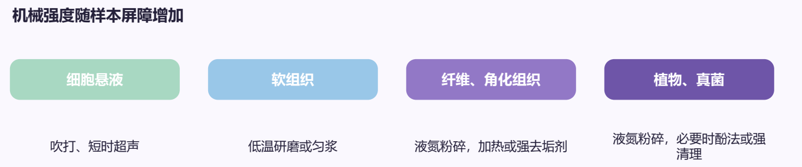
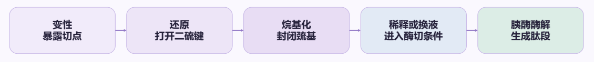
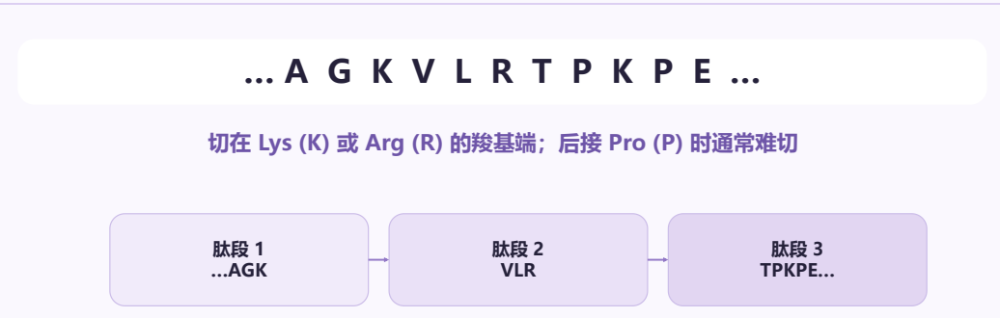
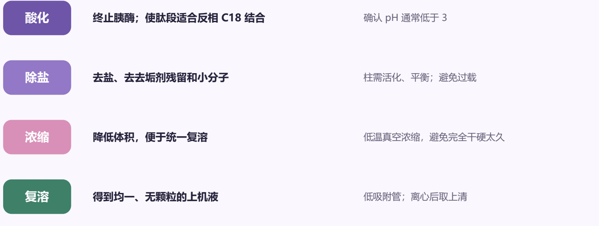
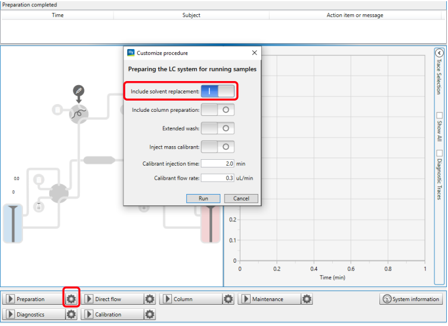
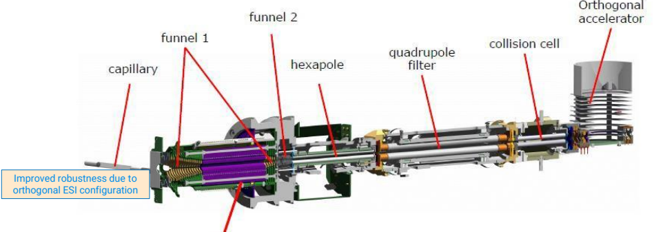
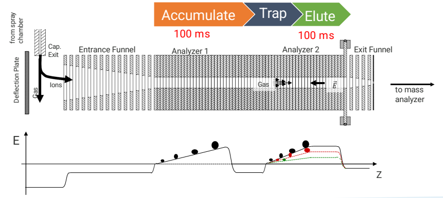
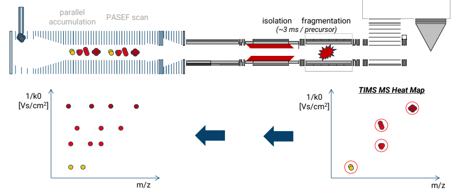
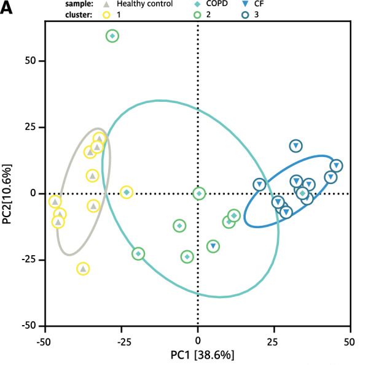

<section class="deck-page cover-page" data-slide="1"><header>
培训学习汇报
<h1>timsTOF 蛋白质组学实验</h1>
蛋白质样品前处理、液相质谱上机检测、结果表解读与气道微生态研究应用
</header><main>

timsTOF

一份生物样品如何变成可解释的蛋白质结果表

<b>01 蛋白质前处理</b>样品采集、裂解提取、定量、酶解与除盐

<b>02 样品上机与电离</b>进样序列、液相色谱分离与电喷雾电离

<b>03 质谱分离与碎裂</b>TIMS 淌度分离、四极杆、碰撞池、TOF 与 PASEF

<b>04 结果解读与应用</b>鉴定定量表读法、组间比较与慢阻肺痰液案例

<small>面向零基础听众的入门汇报，以尿素溶液酶解为前处理教学主线，以气道痰液为应用示例</small>
</main><footer>培训资料 01–11，应用文献见第26–27页（E1–E5）<b>01 / 28</b></footer></section>

<!--
逐页演讲稿：
老师、同学们好。今天我汇报的内容是timsTOF蛋白质组学实验的完整流程，面向还没有接触过质谱和蛋白质研究的同学，把从拿到一份生物样品到读懂最终蛋白质结果表的全过程梳理清楚。

整个汇报按照实验真实的先后顺序分成四块：第一块先讲基础概念和实验全景图；第二块讲实验台上的样品前处理，也就是怎么把细胞或痰液里的蛋白质提取出来并切成干净的肽段溶液；第三块讲样品放进液相色谱和timsTOF质谱仪以后，仪器内部是怎样一步步测出信号的；第四块讲拿到软件生成的蛋白质表格后怎么读表，以及怎样用到慢阻肺气道微生态研究中。

汇报中前处理部分以最常用的尿素溶液酶解作为教学主线，应用部分以气道痰液和慢阻肺文献作为具体例子。我的讲述预计在三十五到四十分钟左右。

原讲者备注：本汇报面向无质谱与蛋白研究基础的听众，按实验真实先后顺序展开：先在实验台把样本里的蛋白质变成干净的肽段溶液，再把样品放上仪器完成液相分离与质谱测量，最后解读软件输出的蛋白表格并用于慢阻肺气道微生态研究。气道与痰液为讲解示例，实际课题队列与SOP待定。预计讲述35至40分钟。
大纲检查点：说明面向零基础听众的讲述顺序，痰液与慢阻肺为研究示例
培训来源索引：research/source-index.json；页码均为PDF物理页。
-->

---

<section class="deck-page " data-slide="2"><header>
01 / 基础概念与总流程
<h1>蛋白质、肽段与蛋白质组学</h1>
实验先将完整蛋白质剪成短小的肽段再上机测量，最后由软件拼回蛋白质名单
</header><main>

<em>基础单元</em><b>氨基酸（Amino Acid）</b>组成蛋白质的基本结构单元

<em>上机测量对象</em><b>肽段（Peptide）</b>约 7 至 30 个氨基酸连成的短链，为质谱直接测量对象

<em>生物学解释对象</em><b>蛋白质（Protein）</b>成百上千个氨基酸折叠而成，在细胞与气道中执行功能

<b>蛋白质组学研究什么问题</b>基因组表示细胞拥有哪些基因蓝图，蛋白质组学直接批量测量样本中实际表达了哪些蛋白质、各蛋白在疾病与健康组之间相对升高还是降低。

<b>为什么完整蛋白质难以直接检测</b>完整蛋白质分子量大、长短和疏水性差异极宽，在液相色谱柱中难以分开，进入质谱后也很难打碎成规律可读的片段。

<b>自下而上（Bottom-up）检测策略</b>前处理阶段用蛋白酶在固定氨基酸位点把完整蛋白质剪成短肽段，质谱仪实测肽段的重量与碎片，再由软件比对数据库推导出原蛋白质。

<b>肽段相比完整蛋白的三个优势</b>短肽段在反相液相色谱中更容易按疏水性分开，在电喷雾中容易带上稳定正电荷，碰撞后能产生规律的氨基酸序列碎片。

</main><footer>10 p2、p5–8（Bottom-up 原理与酶解成肽段的原因）<b>02 / 28</b></footer></section>

<!--
逐页演讲稿：
进入实验步骤之前，我们先理清三个最基本的名词：氨基酸、肽段和蛋白质。氨基酸是组成蛋白质的最小积木；十几个到二三十个氨基酸连成的一小段短链叫做肽段；而成百上千个氨基酸长链折叠成特定空间结构、在细胞或气道里执行具体功能的分子，就是蛋白质。

很多同学第一次接触质谱都会问：既然我们要研究蛋白质，为什么不把完整蛋白质直接打进质谱仪，反而要先用蛋白酶把它剪成短肽段？这是因为天然完整蛋白质的个头差别太大，有的只有几千道尔顿，有的高达几十万道尔顿，而且有的亲水、有的疏水，直接进液相色谱很难分开，进质谱后也很难打碎成规律的片段。

把完整蛋白质在固定位置剪成长度相近的短肽段后，它们在色谱柱里更容易按顺序分离，在电喷雾里更容易带上稳定的正电荷，打碎后也能拼出氨基酸序列。仪器先测清每一条肽段，软件再根据肽段序列反推出原来的蛋白质，这种策略就叫做自下而上（Bottom-up）蛋白质组学。

落实到医学研究里，蛋白质组学最核心的任务就是同时测量样本里成千上万种蛋白质的相对含量，比较疾病组和健康组之间哪些蛋白发生了显著变化，从而找到疾病发生发展的分子线索。

原讲者备注：首次接触质谱时最常问的问题是：既然研究蛋白质，为什么要先用酶把蛋白质切碎？原因是完整蛋白质像大大小小、软硬不一的毛线团，直接进仪器既分不开也打不碎；剪成长度相近的短肽段后，液相色谱和质谱都能稳定测量。这种先切肽段再拼回蛋白的方法称为自下而上（Bottom-up）蛋白质组学。
大纲检查点：解释Bottom-up自下而上策略，说明肽段比完整蛋白更易分离、电离与碎裂
培训来源索引：research/source-index.json；页码均为PDF物理页。
-->

---

<section class="deck-page " data-slide="3"><header>
01 / 基础概念与总流程
<h1>蛋白质组学实验全流程</h1>
实验台前处理把样品变成肽段液，液相质谱把肽段变成谱图，软件把谱图汇总成蛋白表
</header><main><figure class="flow-original"><figcaption>前处理七步主线（10 p9原图）：本汇报以尿素溶液酶解为教学主线，清理、换液与定量的具体位置随方法调整</figcaption></figure>

<em>阶段 01 样品提取</em><b>蛋白提取液</b>输入原始生物样本，经裂解破障与离心澄清释放可溶蛋白，测定浓度后按等量蛋白投料。

<em>阶段 02 酶解清理</em><b>纯净肽段上机液</b>输入等量蛋白液，经变性、还原、烷基化与胰蛋白酶切割生成肽段，再经C18除盐去除尿素和无机盐。

<em>阶段 03 上机采集</em><b>原始色谱与质谱信号</b>输入澄清肽段液，液相色谱按时间分批洗脱，电喷雾产生气相离子，经TIMS与TOF采集谱图（.d文件）。

<em>阶段 04 结果读表</em><b>蛋白质鉴定与定量表</b>输入原始谱图，软件比对物种数据库识别肽段并组装蛋白组，提取色谱峰面积用于组间比较。

前处理决定哪些蛋白能够进入仪器，质谱采集决定信号质量，数据库检索决定最终可读的蛋白表
</main><footer>图：10 p9；全流程衔接：10 p4、p9、p32；01 p10–12；07 p2；11 p4–5<b>03 / 28</b></footer></section>

<!--
逐页演讲稿：
第3页把整个蛋白质组学实验串成四个大阶段，大家可以把每一阶段的输入和输出连起来看。上面的流程图来自前处理培训教材第9页，列出了从取样保存到复溶上机的七个前处理步骤。

第一阶段在实验台前半程完成：输入原始生物样本，通过物理破碎和化学裂解把蛋白质释放到液体里，测准浓度后按相同蛋白质量投料，输出的是澄清的蛋白提取液。第二阶段在实验台后半程完成：把蛋白展开、剪断二硫键并用胰蛋白酶切成短肽段，再通过C18除盐柱洗掉尿素和无机盐，输出的是干净澄清的肽段上机液。

第三阶段交由液相色谱和timsTOF质谱仪完成：自动进样针吸取肽段溶液，液相色谱按疏水性强弱让肽段分批流出，电喷雾把液体肽段变成气相带电离子，再经过TIMS淌度分离和飞行时间测量，输出记录了全部原始谱图的.d数据文件。

第四阶段由检索软件完成：把原始谱图与目标物种的参考数据库比对，认出肽段并汇总成蛋白质相对定量表。前面样品准备得越规范，后面仪器测到的信号和读出的表格才越可靠。

原讲者备注：第3页先把28页汇报的地图铺开。第4到第10页讲实验台上的七步前处理，核心是把复杂样本变成无盐无颗粒的肽段水溶液；第11到第20页讲样品放进仪器后怎样被分离、带电、打碎并记录成信号；第21到第27页讲怎样读懂最终的蛋白表格并结合慢阻肺痰液研究来用。
大纲检查点：交代尿素溶液酶解教学主线，明确前处理、仪器与软件各自的输入和输出
培训来源索引：research/source-index.json；页码均为PDF物理页。
-->

---

<section class="deck-page " data-slide="4"><header>
02 / 蛋白质前处理
<h1>样品采集、分样与保存</h1>
输入原始生物样品，通过快速冷存、单次分装与穿插批次防止蛋白降解和人为误差
</header><main>

<em>步骤 01</em><b>样品采集</b>记录采样方式与时间

<em>步骤 02</em><b>贴码与核对</b>唯一编号绑定临床信息

<em>步骤 03</em><b>混匀与分装</b>按单次用量分装小管

<em>步骤 04</em><b>低温冻存</b>减少室温停留与反复冻融

<em>步骤 05</em><b>穿插批次提取</b>对照组与疾病组同批处理

<b>输入与风险：离体样本仍在发生降解</b>生物样本离开人体或培养环境后，内源蛋白酶仍会继续切割蛋白质。采样到低温冻存的间隔时间如果不一致，会直接改变可检出的蛋白组成。

<b>动作一：唯一编号与关键信息记录</b>每管样本建立唯一编号，记录采样方式（如自发痰或诱导痰）、采集时间、冻存时间、起始体积或湿重，以及患者近期抗生素或激素使用情况。

<b>动作二：混匀后一次分装，避免反复冻融</b>反复冻融会使冰晶破坏蛋白结构并改变上清与沉淀组分。多组学共用同一份痰液时，需在分装前确认样本均一，按单次实验用量分装冻存。

<b>输出与批次设计：组间穿插的冻存样品</b>输出状态明确、编号可追溯的冻存样品管。后续提取时将健康对照与患者样本穿插在同一批次操作，避免把不同日期的操作波动误判为组间差异。

</main><footer>10 p9–10、p18–20、p27、p30；痰液采样与处理记录参考：E3、E4<b>04 / 28</b></footer></section>

<!--
逐页演讲稿：
下面我们进入实验台前处理的第一步：样品采集、分样与保存。这一步输入的是刚从临床或动物实验中获得的原始生物样本，核心任务是让样本在离体后尽快固定状态，避免蛋白质在等待处理的过程中发生降解。

样本离开原有的生理环境后，细胞内外自带的蛋白酶并不会立刻停工，放在室温下越久，被降解的蛋白就越多。所以拿到样本后要先贴好唯一识别编号，把采样方式、采集时间、放进低温冰箱的时间差、起始体积或湿重，以及患者近期是否使用抗生素或激素全部登记清楚。

冻存之前要先混匀并按单次实验用量分装成小管。如果一大管痰液反复拿出来化冻又冻回去，冰晶反复生长会破坏蛋白质结构，也会改变上清和沉淀里的蛋白分布。对于需要同时做16S菌群测序和蛋白质组的痰液样本，分装前更要先确认样本均一，保证分出去的两小管代表同样的起始状态。

到了后续提取那天，还要注意批次平衡：把健康对照和慢阻肺患者样本穿插在同一个批次里操作。如果第一天全做健康人、第二天全做患者，一旦两天的室温或试剂有一点波动，就会把日期误差混进组间比较里。

原讲者备注：实验从拿到样品的那一刻就开始了。如果对照组样本采完立刻放进超低温冰箱，而患者组样本在桌上放了两个小时才冻存，后续测出蛋白差异就分不清是疾病造成的还是降解造成的。E3和E4两篇痰液文献也表明，采样方式、冻存和缓冲处理会影响部分蛋白指标，因此采样和分装记录是后续解释的基础。
大纲检查点：说明处理延迟与冻融对蛋白组成的影响，多组学分样前先确认均一性
培训来源索引：research/source-index.json；页码均为PDF物理页。
-->

---

<section class="deck-page " data-slide="5"><header>
02 / 蛋白质前处理
<h1>细胞裂解与蛋白提取</h1>
输入冻存生物样品，用机械破碎配合化学裂解液打破物理屏障，把蛋白质释放到溶液中
</header><main><figure class="lysis-original"><figcaption>样本屏障与机械处理方式（10 p14原图）：物理屏障越坚韧，所需的机械破碎强度越高</figcaption></figure>

<em>输入对象</em><b>输入：带屏障的原始样本</b>哺乳动物细胞仅有细胞膜；细菌拥有坚韧细胞壁（革兰阳性菌肽聚糖层更厚）；痰液同时包含交联黏液网络、宿主细胞与微生物。

<em>操作与原因</em><b>动作：机械破碎配合化学助溶</b>超声、研磨或液氮粉碎负责从物理上打破屏障；高浓度尿素等化学裂解液负责把释放出来的蛋白质溶解在液体里，同时抑制内源蛋白酶。

<em>输出与质控</em><b>输出：离心澄清的蛋白提取液</b>低温高速离心去除细胞残渣（记录相对离心力g值、温度与时间），取澄清上清进入下一步。若溶液拉丝黏稠，提示释放出的DNA/RNA未充分剪切。

破碎不足会遗漏难裂解的细菌蛋白或膜蛋白，过度超声升温则会引起液体起泡与蛋白修饰变化
</main><footer>图：10 p14；内容：10 p10–11、p14、p17、p19–20、p30；E2<b>05 / 28</b></footer></section>

<!--
逐页演讲稿：
样品从冰箱取出后，第二步是细胞裂解与蛋白提取。这一步输入的是冻存生物样本，动作是利用机械破碎配合化学裂解液打破样本的物理屏障，输出的是离心澄清后的可溶蛋白提取液。

不同样本外面的物理屏障硬度完全不同，所需的破碎力度也不一样。普通培养细胞只有一层薄薄的磷脂细胞膜，轻轻吹打加短时间超声就能破开；动物软组织需要低温匀浆；而细菌外面包裹着坚韧的细胞壁，特别是革兰阳性菌的肽聚糖层非常厚，如果只用温和条件处理，宿主细胞全破了，细菌却还完整留在残渣里。

机械超声或研磨负责把墙推倒，化学裂解液（比如高浓度尿素溶液）则负责把放出来的蛋白质稳稳溶解在水里。操作时要控制超声时间和温度，避免过度发热产生大量泡沫；如果裂解后发现液体像胶水一样拉丝黏稠，通常是细胞核里的DNA释放出来没被打断，需要进一步超声剪切或加核酸酶处理，否则移液器根本吸不准体积。

裂解结束后通过低温高速离心把不溶残渣沉到管底，记录相对离心力g值、温度和时间，吸取澄清上清液进入下一步定量。评价提取好不好，要把溶液黏度、蛋白总回收量和重复性放在一起看。

原讲者备注：裂解提取的目标是把关在细胞或黏液网络里的蛋白质放出来。需要注意两个常见误区：第一，超声破碎释放大量核酸会让溶液像胶水一样拉丝，导致移液器吸取体积不准，需通过超声剪切或核酸酶降低黏度；第二，痰液里宿主细胞很容易裂解，但细菌细胞壁很厚，不能因为测出总蛋白浓度很高就默认细菌也已经充分破壁。
大纲检查点：区分细胞膜、细菌细胞壁与痰液黏液屏障，高黏度提示核酸释放，记录离心g值
培训来源索引：research/source-index.json；页码均为PDF物理页。
-->

---

<section class="deck-page " data-slide="6"><header>
02 / 蛋白质前处理
<h1>蛋白定量与等量投入</h1>
输入澄清蛋白提取液，测定蛋白浓度并换算吸取体积，保证每份样本进入酶解的起始蛋白量相同
</header><main>
基本换算关系：提取蛋白总量（μg）＝ 蛋白浓度（μg/μL）× 提取体积（μL），吸取体积（μL）＝ 计划投入量（μg）÷ 蛋白浓度（μg/μL）
<table class="matrix compact"><thead><tr><th>样本（教学示例）</th><th>测得蛋白浓度</th><th>提取液总体积</th><th>提取蛋白总量</th><th>计划投入 50 μg 需吸取体积</th><th>用裂解缓冲液补齐至 50 μL</th></tr></thead><tbody><tr><th>样本 A（较浓）</th><td>2.5 μg/μL</td><td>100 μL</td><td>250 μg</td><td>50 ÷ 2.5 ＝ 20 μL</td><td>加入 30 μL 缓冲液（终体积 50 μL）</td></tr><tr><th>样本 B（较稀）</th><td>1.0 μg/μL</td><td>100 μL</td><td>100 μg</td><td>50 ÷ 1.0 ＝ 50 μL</td><td>加入 0 μL 缓冲液（终体积 50 μL）</td></tr></tbody></table>

<b>为什么要做缓冲液空白与梯度稀释核对</b>常用 BCA 比色法容易受到高浓度还原剂、去垢剂或深色样本的干扰。测定时必须用同配方裂解液做空白对照，并检查复孔与稀释后换算浓度是否一致。

<b>痰液等复合样本的投入量解释边界</b>按总蛋白等量投入（如统一取 50 μg）能消除提取效率差异，但每份痰液中宿主蛋白与微生物蛋白的比例并不相同，仍需同步记录起始痰液体积或湿重。

</main><footer>10 p17、p21、p30、p32（定量质控与记录要求；表中数值为教学计算示例，非实测数据）<b>06 / 28</b></footer></section>

<!--
逐页演讲稿：
拿到澄清的蛋白提取液后，第三步做蛋白定量与等量投入计算。这一步的原因非常直接：不同样本天生含水量不同、提取效率也有差别，如果不测浓度就每管盲目吸取同样体积去酶解，后面测出的蛋白高低就全是加样量差异。

我们看页面中间的教学计算示例表：假设用BCA方法测出样本A的蛋白浓度是2.5微克每微升，样本B比较稀，只有1.0微克每微升。两边提取液总体积都是100微升，乘一下就知道样本A一共提出来250微克蛋白，样本B提出来100微克蛋白。

现在我们规定每份样本统一投入50微克蛋白进入后续酶解反应：样本A浓度是2.5，用50除以2.5，只需要吸取20微升提取液，再补加30微升裂解缓冲液，凑成50微升反应体系；样本B浓度是1.0，就直接吸取50微升提取液。这样两管样品不仅蛋白质量都是50微克，连反应总体积和缓冲液浓度也完全对齐了。

测BCA定量时要注意，高浓度还原剂或去垢剂会干扰显色读数，所以必须用同配方的裂解缓冲液做空白对照，并做复孔和稀释核对。另外对于痰液样本，就算总蛋白都投了50微克，里面人体宿主蛋白和细菌蛋白各自占多少比例仍然可能不同，所以原始痰液的体积或重量记录一定要保留。

原讲者备注：如果不做蛋白定量、每管都盲目吸取20微升去酶解，那么原本蛋白浓的样本信号就会全面偏高，无法判断是疾病导致蛋白升高还是加样量多。通过表格里的教学示例可以看到：样本A浓度2.5微克每微升，吸20微升就有50微克蛋白；样本B浓度1.0微克每微升，吸50微升才有50微克蛋白，再把两管体积补齐到一致，后续反应条件就完全对齐了。
大纲检查点：用教学示例说明浓度与取样体积换算，提醒痰液等总蛋白投入仍含宿主与微生物比例差异
培训来源索引：research/source-index.json；页码均为PDF物理页。
-->

---

<section class="deck-page " data-slide="7"><header>
02 / 蛋白质前处理
<h1>变性、还原与烷基化</h1>
输入等量蛋白质溶液，依次解开空间折叠、剪断二硫键并封闭巯基，让内部酶切位点充分暴露
</header><main><figure class="chemistry-original"><figcaption>进入酶解前的化学处理流程（10 p15原图）：各步骤按先后顺序衔接，不能颠倒</figcaption></figure>

<em>01 打开折叠</em><b>变性（Denaturation）</b>利用高浓度尿素破坏氢键与疏水相互作用，把紧密折叠成球状的蛋白质长链舒展开，暴露埋在内部的氨基酸。

<em>02 剪断二硫键</em><b>还原（Reduction）</b>加入还原剂 DTT 或 TCEP，剪断把不同肽链段拉拢在一起的二硫键（S-S 键），使其变成两个游离的巯基（-SH）。

<em>03 锁住游离巯基</em><b>烷基化（Alkylation）</b>加入烷基化试剂 IAA 或 CAA（避光反应），给游离巯基（-SH）加上化学保护基团，防止它们被氧化重新连回二硫键。

<em>04 适配蛋白酶</em><b>稀释或换液</b>高浓度尿素也会使后续加入的胰蛋白酶失活；在加酶前必须用缓冲液稀释（如降至约 1 M）或超滤换液。

输出：肽链充分舒展、二硫键已被永久封闭、且变性剂浓度已降至胰蛋白酶耐受范围的反应液
</main><footer>图：10 p15；内容：10 p12、p15；痰液早期DTT液化与蛋白还原的衔接参考：E2–E4<b>07 / 28</b></footer></section>

<!--
逐页演讲稿：
取好等量的50微克蛋白质溶液后，第四步依次完成变性、还原和烷基化。这三个化学动作的目的只有一个：把原本缩成一团的蛋白质彻底打开并固定住，好让下一步的蛋白酶能够顺畅地伸进去切肽键。

天然蛋白质就像一个用绳扣绑紧的毛线球，很多赖氨酸和精氨酸藏在球心，蛋白酶根本够不着。第一步变性，靠高浓度尿素破坏氢键和疏水作用，先把毛线球揉松；第二步还原，加入DTT或TCEP，专门把连接不同肽链段的二硫键（S-S键）剪断，变成两个游离的巯基（-SH），毛线团就彻底散开了。

但剪断后的两个游离巯基如果放着不管，遇到空气氧化又会重新连回二硫键。所以紧接着第三步做烷基化：加入IAA或CAA并在避光条件下反应，给每个游离巯基戴上一顶化学保护帽，把它们永久锁住。

做完这三步、在正式加入胰蛋白酶之前，还有一个必不可少的衔接动作——稀释或换液。因为前面用来展开蛋白的高浓度尿素同样会把胰蛋白酶本身变性废掉，必须先用弱碱性缓冲液把尿素稀释到约1摩尔每升以下的酶耐受范围，同时避免尿素长时间高温引起人为修饰。如果痰液在最开始液化阶段加过DTT，还要把那部分残留一并算进还原体系里。

原讲者备注：可以把天然蛋白质想象成一个用绳扣绑紧的毛线团：变性是把毛线团揉松，还原是用剪刀把绑紧毛线的二硫键剪断，烷基化是在剪断的绳头套上保护帽防止它重新打结。如果跳过还原和烷基化，蛋白内部很多赖氨酸和精氨酸位点被二硫键挡住，胰蛋白酶就切不进去。另外尿素避免长时间高温，以防发生人为氨甲酰化修饰。
大纲检查点：说明每步化学作用及先后顺序，区分痰液早期DTT液化与蛋白还原步骤的残留统筹
培训来源索引：research/source-index.json；页码均为PDF物理页。
-->

---

<section class="deck-page " data-slide="8"><header>
02 / 蛋白质前处理
<h1>胰蛋白酶酶解</h1>
输入舒展的蛋白质长链，利用胰蛋白酶在赖氨酸和精氨酸羧基端特异切割，生成规则短肽段
</header><main>
<figure class=""><figcaption>胰蛋白酶（Trypsin）切割示意（10 p7原图）：在 K 和 R 羧基端切割，后接脯氨酸 P 时通常难切</figcaption></figure>
<ul class="explain"><li><b>胰蛋白酶（Trypsin）的切割规则</b>专门识别赖氨酸（Lys, K）和精氨酸（Arg, R），在它们的羧基端切开肽键；若紧跟着脯氨酸（Pro, P）则因空间位阻通常难切。切割规则明确，便于软件检索。</li><li><b>酶解反应的环境要求</b>通常在弱碱性缓冲液（约 pH 8）、37℃ 条件下反应。切出的肽段末端带有碱性氨基酸（K 或 R），在后续正离子电喷雾中很容易带上正电荷。</li><li><b>质量指标：漏切（Missed Cleavage）</b>本该被切开的 K/R 位点如果未切开，称为漏切。后续搜库若发现漏切肽段比例异常升高，说明尿素残留过高、pH 不对或酶活不足。</li></ul>

本步小结：输入展开的蛋白质溶液，经胰蛋白酶在 K/R 位点特异切割，输出数万条序列规则的肽段混合物
</main><footer>图：10 p7；内容：10 p6–7、p15、p17、p29<b>08 / 28</b></footer></section>

<!--
逐页演讲稿：
反应体系调整到位后，第五步就是整个前处理最核心的胰蛋白酶酶解。这一步输入的是完全舒展开的蛋白质长链，动作是用胰蛋白酶在特定氨基酸位置下刀，输出的是成千上万条长短合适的肽段混合物。

为什么大家都选胰蛋白酶（Trypsin）来做这件事？看左边的培训原图：蛋白质是一串由20种氨基酸排成的长链，胰蛋白酶就像一把带定位导航的剪刀，专门寻找赖氨酸（K）和精氨酸（R），并精准切在它们的羧基端（也就是右边）；只有当K或R后面紧挨着脯氨酸（P）时，因为空间结构卡住才通常切不开。图中序列切完后，就变成了AGK、VLR和TPKPE三条清晰的肽段。

这种切割规则带来两个巨大好处：第一，K和R在蛋白质里分布均匀，切出来的肽段大多数在7到25个氨基酸之间，不长不短正适合液相色谱分离和质谱碎裂；第二，每条肽段尾巴上都留着一个碱性的K或R，后面做电喷雾时特别容易抓住氢离子带上正电。

酶解通常在37度、弱碱性缓冲液里进行。如果前面尿素没稀释够、或者pH不对，胰蛋白酶就会偷懒，导致很多本该切开的K和R没切开，这在后续数据分析里叫做“漏切（Missed Cleavage）”。反过来，后续看数据里的漏切率高不高，就能帮我们回头检查这一步酶解做得成不成功。

原讲者备注：为什么全世界做蛋白质组学首选胰蛋白酶（Trypsin）？第一，它下刀非常守规矩，只切赖氨酸K和精氨酸R的右边，切出来的肽段长度大多在7到25个氨基酸之间，正好处在质谱最擅长测量的范围；第二，K和R都是碱性氨基酸，留在肽段尾巴上正好能抓住氢离子带正电。原图序列清楚展示了AGK、VLR和TPKPE三段产物，其中K后面因为紧挨着P所以没有切开。
大纲检查点：解释为什么常用胰蛋白酶、Pro后难切规则，以及漏切率在排查酶解条件中的作用
培训来源索引：research/source-index.json；页码均为PDF物理页。
-->

---

<section class="deck-page " data-slide="9"><header>
02 / 蛋白质前处理
<h1>酸化、除盐与复溶</h1>
输入含有尿素和无机盐的酶解反应液，去除小分子干扰物并浓缩复溶，得到澄清的上机肽段液
</header><main>
<figure class=""><figcaption>酶解后清理四步流程（10 p16原图）：去除缓冲盐与变性剂，同时尽量减少肽段损失</figcaption></figure>
<ul class="explain"><li><b>第一步：酸化（Acidification）</b>向酶解液中加入甲酸或三氟乙酸使 pH 降至 3 以下，一方面立刻终止胰蛋白酶活性，另一方面让肽段质子化，便于结合到反相除盐柱上。</li><li><b>第二步：C18 反相柱除盐（Desalting）</b>疏水的肽段吸附在 C18 填料上，亲水的无机盐和尿素随水相直接流走被洗掉；随后用含乙腈的有机溶液把纯净肽段洗脱收集下来。</li><li><b>第三步：低温真空浓缩与复溶</b>真空离心挥发掉洗脱液中的有机溶剂（避免长时间彻底干硬导致难溶），再用上机兼容的稀酸水溶液复溶，转入低吸附管高速离心取上清。</li></ul>

普通 C18 除盐柱用于去除无机盐和尿素；若前处理使用 SDC 或 SDS 等去垢剂，需先按对应路线去除去垢剂
</main><footer>图：10 p16；内容：10 p12–13、p16、p26、p32<b>09 / 28</b></footer></section>

<!--
逐页演讲稿：
蛋白质切成肽段以后，还不能直接往质谱仪里打，必须先做第六步：酸化、C18除盐、浓缩与复溶。因为此时的酶解液里除了肽段，还泡着大量尿素和缓冲盐，这些小分子杂质不除掉会直接毁掉质谱信号。

清理过程分四步走：第一步先加酸（比如甲酸或三氟乙酸），把溶液pH降到3以下，一方面立刻让胰蛋白酶停止工作，另一方面让肽段带上正电，准备好结合除盐柱。第二步过C18反相除盐柱：C18填料表面是疏水的碳链，肽段有疏水基团，流过去时会被C18牢牢抓住；而无机盐和尿素极性很强、喜欢水，用稀酸水一冲就全流进废液缸了；洗干净盐以后，再换含有机溶剂乙腈的洗脱液，把抓在柱子上的纯净肽段洗脱到新管子里。

第三步把洗脱液放进低温真空浓缩仪里旋干，挥发掉里面的乙腈；这里要注意不能长时间彻底烤成干硬的薄膜，否则肽段吸附在管壁上很难再溶下来。第四步加入几微升至几十微升与液相流动相兼容的稀酸水溶液把肽段重新溶解，装进低吸附管高速离心，取上清液待测。

这里补充一点不同前处理路线的区别：我们主线讲的尿素体系用普通C18柱就能除干净；但如果实验用的是SDC（脱氧胆酸钠）裂解液，必须在加酸时先通过沉淀或相分离把SDC除掉，再过C18柱；如果用的是去垢力最强的SDS，普通C18柱根本除不掉SDS，就必须采用SP3磁珠、S-Trap柱或FASP超滤膜等专门路线把SDS洗掉后再酶解。

原讲者备注：刚切完的肽段溶液里混着大量尿素和缓冲盐，如果直接打进液相质谱，盐分会在离子源结晶并严重压制肽段带电。C18除盐柱就像一块“吸油不吸水”的海绵：肽段有一定疏水性，会被C18抓住；盐和尿素亲水，用水一冲就洗掉了；最后再用乙腈把肽段洗下来。讲稿这里补充说明：如果实验用的是SDC裂解液，要先酸化沉淀或相分离去掉SDC再过C18；如果用的是SDS，则要走SP3、S-Trap或FASP路线。
大纲检查点：讲清C18留肽去盐原理，避免浓缩过度干硬；讲稿补充SDC与SDS路线的清理差异
培训来源索引：research/source-index.json；页码均为PDF物理页。
-->

---

<section class="deck-page " data-slide="10"><header>
02 / 蛋白质前处理
<h1>上机前样品检查</h1>
在把肽段管放进液相自动进样器之前，逐项核对五项放行指标，防止堵柱、污染或进样量失真
</header><main><table class="matrix compact"><thead><tr><th>放行检查项</th><th>上机前具体核对什么</th><th>如果不合格会造成什么问题</th><th>处理动作与放行要求</th></tr></thead><tbody><tr><th>01 编号与过程空白</th><td>样本管标签、分组记录与随同处理的过程空白管（Process Blank）</td><td>样品孔位放错导致组别混淆，或无法排查试剂耗材带来的背景污染</td><td>核对样品表与管身编号一致，过程空白随序列一同上机</td></tr><tr><th>02 溶液澄清度</th><td>对着光线观察复溶后的肽段溶液是否透明，有无肉眼可见微粒、浑浊或纤维</td><td>微小颗粒进入纳升液相管路会直接堵塞色谱柱，导致柱压飙升停机</td><td>上机前必须在低吸附管中再次高速离心，仅吸取上层澄清液装入进样瓶</td></tr><tr><th>03 化学兼容性</th><td>确认已完成酸化（pH 低于 3）与 C18 除盐，无高盐或去垢剂残留</td><td>残余盐分压制电喷雾信号，残余去垢剂污染色谱柱与质谱离子源</td><td>未除盐或去垢剂清理不彻底的样品严禁进入 LC–MS 系统</td></tr><tr><th>04 肽段浓度与体积</th><td>核对复溶体积、肽段浓度以及计划进样体积（例如进样 200 ng 对应几微升）</td><td>进样量过低导致低丰度蛋白漏检，进样量过高导致色谱峰平头与残留污染</td><td>记录复溶体积与浓度，确认进样瓶内液面高度足够进样针安全吸取</td></tr><tr><th>05 前处理偏差记录</th><td>回查裂解黏度、定量稀释、酶解时长及除盐洗脱过程有无异常情况</td><td>下机后若发现单针信号极低，无法判断是仪器故障还是该管样品损失</td><td>将存在制备偏差的样品提前登记在册，读表时结合过程记录复核</td></tr></tbody></table></main><footer>10 p17、p29、p30、p32；02 p25–26<b>10 / 28</b></footer></section>

<!--
逐页演讲稿：
做完复溶离心，样品还在实验台上，第10页是把样品交给质谱仪之前的最后一道关口：上机前五项放行检查。这一步的目的是把样品问题拦在进样器外面，防止损坏仪器或白跑几十个小时。

第一查编号与过程空白：核对样品管上的标签和实验记录本是否一一对应，同时准备一管从头到尾没加生物样本、只加了全套试剂和酶的“过程空白（Process Blank）”跟着一起上机，用来检查试剂和耗材干不干净。

第二查溶液澄清度：拿起复溶管对着光看，溶液必须完全透明，不能有任何肉眼可见的悬浮颗粒、浑浊或纤维。因为后面纳升液相色谱柱和连接管的内径只有几十微米，哪怕吸进一颗极小的碎屑，柱压就会立刻飙升把色谱柱堵死。所以装进样瓶前一定要再次高速离心，只吸上层清液。

第三查化学兼容性，确认每一管都已经做完酸化和除盐。第四查浓度与体积，记录复溶了多少微升、测得的肽段浓度是多少，算出上机进样几微升正好对应目标上样量（比如200纳克），并确认进样小瓶里的液面高度足够进样针吸取。第五查过程偏差记录，把哪一管裂解时偏黏、哪一管浓缩时间偏长记清楚，方便后面读表时核对。

原讲者备注：第10页是实验台前处理与质谱仪交接的关口。质谱仪前面的纳升液相色谱管路内径只有几十微米，比头发丝还细，只要样品里有一点点肉眼看不清的沉淀颗粒，几针下去就会把几千元的色谱柱堵死。因此，上机前确认“已酸化、已除盐、离心取澄清上清、体积和浓度已记录”是保护仪器和数据质量的硬性要求。
大纲检查点：明确颗粒堵柱、盐与去垢剂污染离子源的风险，把样品放行与仪器准备衔接起来
培训来源索引：research/source-index.json；页码均为PDF物理页。
-->

---

<section class="deck-page " data-slide="11"><header>
03 / 样品上机与仪器工作
<h1>样品放置与进样序列</h1>
输入澄清肽段样品瓶，完成液相清洗平衡与质谱校正后，按空白、质控样到个人样本的顺序启动序列
</header><main>

<em>01</em>
<b>液相准备与质谱校正</b>配制并超声脱气流动相 A（0.1% 甲酸水）与 B（0.1% 甲酸乙腈），执行溶剂替换、洗针与色谱柱平衡；用标准校正液校准质谱的质荷比（m/z）与离子淌度。

<em>02</em>
<b>放入样品盘并填写序列表</b>把装有澄清肽段液的进样小瓶放入自动进样器指定孔位（如 Slot 1:2），在 Compass HyStar 序列表中填入样本名、孔位、进样体积（μL）、液相方法与质谱方法。

<em>03</em>
<b>先运行空白（Blank）与质控样（QC）</b>正式进个人样本前，先打空白样检查管路背景是否干净，再打已知表现的标准质控样（如 HeLa 酶解标样）确认出峰时间、信号强度和柱压正常。

<em>04</em>
<b>核对首针样本，穿插监控跑完全序列</b>个人样本跑完第一针后，立刻调出总离子流图与柱压曲线检查；确认无异常后继续批量运行，每 6 至 8 针样本之间穿插一针 QC 与 Blank。

<figure class=""><figcaption>Compass HyStar 负责液相控制与样本序列调度，timsControl 负责质谱采集参数与校正（02 p13原图）</figcaption></figure>
</main><footer>图：02 p13；步骤：02 p5、p11–26<b>11 / 28</b></footer></section>

<!--
逐页演讲稿：
从第11页开始，我们的样品正式离开实验台，放进液相色谱—质谱联用仪（LC-MS）里。第一步是仪器准备、放入样品瓶和编辑进样序列。

在跑样品之前，先要把仪器调整到稳定状态。液相部分配好两瓶流动相：A相是含0.1%甲酸的纯水，B相是含0.1%甲酸的乙腈；超声脱气后，在右图展示的Compass HyStar软件里执行溶剂替换、管路清洗、洗针和色谱柱平衡。等液相流速和压力稳定了，再在timsControl软件里注入标准校正液，把质谱仪测质荷比（m/z）和离子淌度的标尺校准到100%合格。

接着我们把装有澄清肽段液的进样小瓶，按顺序放进自动进样器的样品盘孔位里（比如1号盘第2孔，记为Slot 1:2）。然后在HyStar的序列表里一行行填好：样品名称、所在孔位、进样针吸取体积（比如1微升）、调用哪条液相洗脱方法和哪套质谱采集方法，保存并上传条件。

启动序列的顺序很有讲究：绝对不能上来第一针就打珍贵的临床样本，而是先打一针空白（Blank）看背景干不干净，再打一针已知表现的标准质控样（QC，比如标准HeLa细胞酶解肽段）确认今天仪器灵敏度和保留时间完全正常；接着跑第一针个人样本，停下来检查峰形、信号强弱和柱压都没问题后，再批量运行后面的序列，并且每跑6到8针个人样本就穿插一针QC和一针Blank。

原讲者备注：检查合格的肽段溶液装进进样小瓶后，放进自动进样器的样品盘里。自动进样器就像一个按表格办事的机械手：我们在HyStar软件的序列表（Sequence Table）里写清楚“第2行去1号盘2号孔吸1微升样品，调用60分钟液相梯度和DIA质谱方法”，机械针就会自动吸样注入系统。上机铁律是：先看QC确认仪器健康，再看首针确认个人样品浓度合适且不堵柱，然后再放心让仪器自动跑完整个队列。
大纲检查点：说明HyStar与timsControl分工、进样针吸样、首针检查及每6–8针穿插QC和Blank
培训来源索引：research/source-index.json；页码均为PDF物理页。
-->

---

<section class="deck-page " data-slide="12"><header>
03 / 样品上机与仪器工作
<h1>液相色谱分离与保留时间</h1>
输入混合在一起的数万种肽段，利用反相色谱柱按疏水性强弱分批洗脱，记录出峰保留时间
</header><main>

<em>01 样品注入</em><b>进样针注入肽段液</b>数万种肽段同时进入色谱柱头

<em>02 柱上保留</em><b>C18 柱疏水吸附</b>起始高水相下肽段挂在柱填料上

<em>03 梯度洗脱</em><b>乙腈比例逐步升高</b>流动相 B（0.1%甲酸乙腈）按梯度增加

<em>04 分批出柱</em><b>按疏水性先后流出</b>亲水肽段先流下，疏水肽段后流下

<em>05 输出液流</em><b>记录保留时间 RT</b>形成几秒宽的色谱峰进入质谱

<em>分离原因</em><b>为什么质谱前面要接液相色谱（LC）</b>一份酶解样本含有几万条不同肽段。如果一瞬间全部涌入质谱，强信号会掩盖弱信号，质谱也来不及逐一打碎；液相色谱把它们分散到几十分钟内排队进入。

<em>时间坐标</em><b>保留时间（Retention Time, RT）</b>某一条肽段从进样针注入开始计时，到被流动相从色谱柱洗脱出来、进入质谱的那一刻所经历的时间（单位为分钟或秒），是识别该肽段的时间坐标。

<em>定量基础</em><b>色谱峰（Chromatographic Peak）</b>同一种肽段的一群分子集中在数秒内（如半峰宽约 7 秒）流出，信号从基线上升到最高点再回落，形成的钟形曲线即为色谱峰，峰面积反映该肽段多少。

本步小结：输入混合肽段溶液，经反相液相梯度洗脱分离，输出按保留时间（RT）先后流出的肽段液流
</main><footer>01 p10–12；02 p9–11；07 p2<b>12 / 28</b></footer></section>

<!--
逐页演讲稿：
点击开始序列后，自动进样针从样品瓶里吸取1微升肽段溶液注入系统，首先进入仪器工作的第一步：液相色谱（LC）分离。这一步解决的问题是：一微升样品里混着几万种不同肽段，怎样让它们排好队分批进入质谱仪？

如果把几万种肽段在同一秒钟直接塞进质谱仪，就像几万人同时涌进一个检票口，强信号会把弱信号彻底淹没，质谱仪也根本来不及一个个拍照。液相色谱柱里面装满了疏水的C18填料颗粒，当肽段溶液刚进柱子时，流动相里绝大多数是水（A相），几万种肽段因为疏水作用全都抓在柱子填料上停住。

随后，液相泵按照设定的梯度方法，把有机溶剂乙腈（B相）的比例一点点往上升（比如在几十分钟内从2%升到35%）。那些疏水性弱、比较喜欢水的肽段最先松手，顺着水流走出柱子；疏水性强的肽段抓得紧，要等乙腈比例升得更高时才松手流出来。这样一来，几万种肽段就被均匀拉开在几十分钟的时间轴上，分批走出色谱柱。

这里要记住两个贯穿始终的基础名词：第一是“保留时间（Retention Time, 简称RT）”，指某一条肽段从进样开始算起，在柱子里呆了多少分钟才流出来，这是每条肽段专属的出场时间坐标；第二是“色谱峰”，同一种肽段的上百万个分子走出柱子通常持续几秒钟（比如峰宽约7秒），信号从零升到峰顶再落回零，画出来的峰面积就代表这种肽段有多少。

原讲者备注：为什么质谱仪前面总是连着一台液相色谱（LC），合称“液质联用（LC-MS）”？因为一份样本里有几万种肽段，如果同一秒钟挤进质谱，就像几万人同时挤进一扇门，谁也看不清。液相色谱柱里面的C18填料能拉住疏水性强的肽段：刚开始多用水相冲洗，亲水的肽段先走出来；随着乙腈比例慢慢升高，疏水肽段陆续松手走出来。每条肽段在第几分钟走出来，就叫做它的保留时间（RT）。
大纲检查点：解释几万种肽段分批进入质谱的原因，说明保留时间RT与色谱峰宽的物理含义
培训来源索引：research/source-index.json；页码均为PDF物理页。
-->

---

<section class="deck-page " data-slide="13"><header>
03 / 样品上机与仪器工作
<h1>电喷雾电离产生气相离子</h1>
输入从色谱柱流出的液体肽段，通过高压喷雾与加热干燥脱去溶剂，转变为气相带正电离子
</header><main>

<em>01 液相流出</em><b>色谱柱流出肽段溶液</b>含水、乙腈与 0.1% 甲酸（提供 H⁺）

<em>02 电喷雾</em><b>高压喷针形成带电雾滴</b>喷针尖端施加高电压产生细小液滴

<em>03 脱去溶剂</em><b>伴热干燥气吹干溶剂</b>水与乙腈迅速挥发，液滴缩小裂解

<em>04 进入质谱</em><b>气相多电荷肽段离子</b>肽段携带 2 至 3 个正电荷进入真空腔

<em>物理前提</em><b>为什么要把液体分子变成气相离子</b>质谱仪内部是高真空环境，完全依靠电场来引导、筛选和加速粒子。不带电的中性分子在电场中不受力，只有带上电荷成为离子才能被质谱测量。

<em>电荷来源</em><b>肽段为什么常带 +2 或 +3 个正电荷</b>流动相中的甲酸提供大量氢离子（H⁺）。胰蛋白酶切出的肽段在氨基端以及尾部的赖氨酸（K）或精氨酸（R）侧链都能结合 H⁺，常形成二价或三价正离子。

<em>抗污设计</em><b>正交电喷雾构型（Orthogonal ESI）的作用</b>喷雾方向与进样毛细管呈一定角度，利用偏转板电场只把带正电的肽段离子拉进毛细管，而未充分挥发的中性液滴和颗粒顺气流排走，保护仪器免受污染。

本步小结：输入色谱柱流出的肽段溶液，经高压电喷雾与加热去溶剂，输出进入真空腔的气相带正电肽段离子
</main><footer>01 p12、p14、p22；10 p6–7<b>13 / 28</b></footer></section>

<!--
逐页演讲稿：
肽段顺着流动相走出色谱柱后，还溶解在水和乙腈液体里；而质谱仪内部是高真空管道，只能用电场控制带电粒子。第13页讲的仪器第二步“电喷雾电离（ESI）”，就是把液体里的中性肽段变成真空中带正电的气相离子。

为什么要做电离？因为在后面的离子淌度管、四极杆和飞行时间管里，没有任何机械推手，全靠正负电极产生的电场来推拉粒子。如果一个分子不带电，电场对它就毫无办法，质谱仪就成了瞎子。所以进入质谱前，必须先给每条肽段充上电，还要把包裹它的水分和乙腈彻底吹干。

电喷雾是怎么做到的呢？从色谱柱流出的细微液流，通过一根加了上千伏高电压的喷针尖端，在强电场拉扯下炸成漫天极细的带电小雾滴。与此同时，温热的干燥氮气迎面吹来，雾滴里的水分和乙腈迅速蒸发，液滴越缩越小，表面的正电荷互相排斥，最终让一条条肽段分子抓着氢离子脱离液滴，单独悬浮到气相中。

为什么胰蛋白酶切出的肽段特别适合电喷雾？因为流动相里加了0.1%的甲酸，水里到处都是游离的氢离子（H+）；而胰蛋白酶切出的肽段不仅头部的氨基能抓一个H+，尾巴上的赖氨酸（K）或精氨酸（R）也是碱性的，还能再抓一两个H+，所以变成气相离子后通常带着2个或3个单位的正电荷。另外timsTOF入口采用正交喷雾设计，靠偏转电压只把带正电的离子吸进毛细管，没挥发干的中性液滴和脏东西直接顺气流排走，大大减少了仪器污染。

原讲者备注：从液相色谱柱流出来的是液体，而质谱仪内部是抽成真空的管道，靠电场控制粒子运动。怎样把溶解在水和乙腈里的肽段变成悬浮在真空里的带电粒子？这一步就叫电喷雾电离（ESI）：液体流过带高压电的细针头，炸成极细的带电水雾，热风一吹把水分和乙腈吹干，肽段本身抓着两三个氢离子（H+）留在空中，就变成了气相带正电离子，被吸进质谱仪入口。
大纲检查点：说明质谱电场只能操控带电离子，解释胰酶肽段常带2–3个正电荷及正交喷雾防污染作用
培训来源索引：research/source-index.json；页码均为PDF物理页。
-->

---

<section class="deck-page " data-slide="14"><header>
03 / 样品上机与仪器工作
<h1>timsTOF 内部离子通路</h1>
气相肽段离子进入质谱后，依次经过双 TIMS、四极杆、碰撞池与飞行时间管，测出四维信息
</header><main><figure class="wide-figure"><figcaption>timsTOF 内部硬件通路（01 p12原图，从左向右阅读）：各部件分工协作，依次完成淌度分离、母离子挑选、碎裂与质量测定</figcaption></figure>

<em>入口导入</em><b>① 毛细管与漏斗</b>Capillary / Funnel：导入离子并聚焦进入真空区

<em>淌度分离</em><b>② 双 TIMS 淌度管</b>Dual TIMS：按离子空间形状大小分离（测 1/K₀）

<em>挑选母离子</em><b>③ 四极杆质量过滤器</b>Quadrupole Filter：按质荷比挑选特定母离子

<em>碰撞打碎</em><b>④ 碰撞池</b>Collision Cell：母离子撞击气体打碎成碎片子离子

<em>测定质荷比</em><b>⑤ 正交加速与 TOF</b>Orthogonal Accelerator & TOF：测飞行时间算 m/z 与强度

整套系统对每个肽段同时记录四项信息：液相保留时间（RT）、离子淌度（1/K₀）、质荷比（m/z）与信号强度（Intensity）
</main><footer>图：01 p12；概念：01 p10–14<b>14 / 28</b></footer></section>

<!--
逐页演讲稿：
现在，脱离了溶剂的气相带正电肽段离子正式被吸进timsTOF质谱仪内部。第14页我们先看一张仪器内部的路线总图，把后面几页要讲的硬件关卡在脑子里对上号。

看上面这张来自培训资料第1册第12页的剖面原图，离子从左边进来、往右边走，一共要闯过五个核心关卡：第一关是左边的进样毛细管（capillary）和离子漏斗（funnel 1），它们把散开的离子像漏斗一样聚拢导入真空腔。第二关是中间紫色的双捕集离子淌度管（Dual TIMS），它负责按离子的空间高矮胖瘦排队分离，测出离子的淌度（写成1/K0）。

走出TIMS后，经过funnel 2和六极杆（hexapole）平稳传输，来到第三关——四极杆质量过滤器（quadrupole filter）。四极杆就像一个精准的筛子，只挑出某一种特定重量的完整肽段离子（母离子）放行。第四关是紧挨着的碰撞池（collision cell），被挑中的母离子在这里撞击氮气分子，被打断成一串氨基酸序列碎片（子离子）。

第五关是最右边的正交加速器（Orthogonal accelerator）和竖直向上的飞行时间管（TOF），它们通过测量离子飞抵检测器所需的时间，算出每个母离子或碎片离子的质荷比（m/z）以及信号强度（Intensity）。液相的保留时间RT、TIMS的淌度1/K0、TOF的质荷比m/z再加上信号强度，合起来就是常说的四维（4D）蛋白质组学测量信息。

原讲者备注：现在气相肽段离子已经进入质谱仪内部了。看着上面这张横剖面原图，从左往右一共走过五个核心关卡：最左边是进样毛细管（capillary）和离子漏斗（funnel 1），把离子收拢进来；接着紫色的管子是双TIMS淌度分析器，按离子的胖瘦形状排队；再往右经过六极杆传输到四极杆过滤器（quadrupole filter），挑出目标肽段；然后在碰撞池（collision cell）里撞碎；最后到达最右边的正交加速器和飞行时间管（TOF）测出质量。下面三页我们把TIMS、四极杆碰撞池和TOF逐一拆开讲清楚。
大纲检查点：将图中英文部件逐一对应中文名称与功能，串起RT、淌度1/K₀、m/z与信号强度四维信息
培训来源索引：research/source-index.json；页码均为PDF物理页。
-->

---

<section class="deck-page " data-slide="15"><header>
03 / 样品上机与仪器工作
<h1>TIMS 捕集与淌度分离</h1>
利用向右的气流推力与向左的反向电场平衡捕集离子，再逐步调低电场按离子空间形状依次释放
</header><main>
<figure class=""><figcaption>双 TIMS 结构与电场台阶示意（01 p14原图）：前段 Analyzer 1 累积离子，后段 Analyzer 2 淌度分离（100 ms 为示例）</figcaption></figure>
<ul class="explain"><li><b>第一步：捕集（Trap），顺风推力平衡反向电场</b>通道内有从左向右吹的载气（Gas）推着离子往前走，同时施加从右向左的反向电场（E）把正离子往回拉。体型蓬松肥大、受风面积大的离子被推到靠右的强电场区停下，体型紧凑瘦小的离子停在靠左的弱电场区。</li><li><b>第二步：释放（Elute），缓慢降低电场门槛</b>当反向电场台阶逐步调低时，停在最右侧的大截面离子最先跨过门槛飞出通道，随后较小截面的离子按顺序依次释放，由此测出约化离子淌度倒数（1/K₀，单位 V·s/cm²）。</li><li><b>为什么设计成前后两段（Dual TIMS）</b>后段（Analyzer 2）花 100 ms 把当前一批离子按形状放出去的同时，前段（Analyzer 1）正好把源源不断新进来的下一批离子存起来，实现“边存边分”，几乎不浪费离子。</li></ul>

</main><footer>图：01 p14；解释：01 p10–11、p14–16<b>15 / 28</b></footer></section>

<!--
逐页演讲稿：
下面我们把刚才路线图里的核心关卡逐一拆开。第15页看仪器第三步：双TIMS管是怎样按“空间形状和胖瘦”把离子分开的。这里完全不用记物理公式，只需要看懂左图里“风往右吹、电场往左拉”的平衡过程。

当气相正离子进入TIMS通道时，通道里有稳定的载气（Gas）从左往右吹，推着所有离子往右走；与此同时，通道内施加了从右往左的反向电场（E），把带正电的离子往左拉。如果一条肽段折叠得蓬松肥大，它的迎风面积（碰撞截面积）就大，受到向右的风推力也大，要一直被吹到右边电场很强的斜坡高处才能停下来；相反，折叠得紧凑瘦小的离子受风力小，在左边电场较弱的低处就停住了。这一步就叫“捕集（Trap）”。

不同胖瘦的离子在斜坡上按位置停好后，下一步叫“释放（Elute）”：仪器把反向电场的高度一点点往下降。原本停在最右边斜坡顶上的胖大离子最先挡不住风力，第一个越过门槛飞出出口；接着中等个头的离子飞出去，最瘦小的离子最后飞出去。根据每个离子飞出来时的电压门槛，就能测出它的离子淌度指标1/K0。哪怕两条肽段氨基酸组成一模一样、重量完全相同，只要空间形状一胖一瘦，TIMS就能把它们分得清清楚楚。

那为什么要做成前后两节（Analyzer 1和Analyzer 2）的双TIMS呢？因为电喷雾每时每刻都在源源不断地送新离子进来。如果只有一节管子，它在花100毫秒慢慢放离子的时候，外面新来的离子就进不来白白浪费了；做成两节以后，后半节花100毫秒按胖瘦放离子的同时，前半节正好把这100毫秒内新进来的下一批离子存起来，上一批放完下一批立刻顶上，离子利用率接近100%。

原讲者备注：TIMS的全称是捕集离子淌度谱。它的工作原理可以用一个直观的画面来理解：想象一条隧道里有稳定的顺风把粒子往出口吹，同时出口处有一个斜坡电场把带正电的粒子往回推。个头越胖大、越兜风的离子，顺风推力越大，就能爬到斜坡更高处停住；个头瘦小的离子停在斜坡低处。接着我们把斜坡高度慢慢往下降，停在最高处的胖离子就第一个冲出出口，瘦离子后出来。哪怕两条肽段重量完全一样，只要空间折叠形状一胖一瘦，TIMS就能把它们分开。
大纲检查点：用顺风推力与电场阻挡解释离子按胖瘦分离，说明前段累积与后段分离并行，不展开公式
培训来源索引：research/source-index.json；页码均为PDF物理页。
-->

---

<section class="deck-page " data-slide="16"><header>
03 / 样品上机与仪器工作
<h1>四极杆筛选与碰撞池碎裂</h1>
四极杆先按质荷比挑出单一母离子，再送入碰撞池打断肽键产生碎片子离子，用于推导氨基酸序列
</header><main>

<em>输入：完整母离子</em><b>TIMS 释放的母离子群</b>完整未碎裂的肽段离子（测得一级质谱 MS1）

<em>动作 01：精准挑人</em><b>四极杆（Quadrupole）</b>只允许指定 m/z 窗口的母离子通过，挡住其他离子

<em>动作 02：打碎肽键</em><b>碰撞池（Collision Cell）</b>母离子加速撞击惰性氮气分子，在肽键处断裂

<em>输出：序列碎片</em><b>碎片子离子群（Fragment）</b>长短不一的氨基酸序列片段（测得二级质谱 MS2）

<em>概念 01</em><b>母离子（Precursor）与一级质谱（MS1）</b>还没有被打碎的完整肽段离子称为母离子（或前体离子）。不打碎直接测量当前有哪些母离子及其强度的谱图，称为一级质谱（MS1）。

<em>概念 02</em><b>四极杆为什么要先做“隔离筛选”</b>如果让几十种不同肽段同时进碰撞池打碎，几百个碎片混在一起就分不清谁是谁的碎片。四极杆像安检门一样，每次只放行特定质荷比范围的母离子进入碰撞池。

<em>概念 03</em><b>碰撞池打碎肽段为什么能推出序列（MS2）</b>两条肽段如果氨基酸种类相同但排列顺序不同（例如 AGK 与 GAK），完整母离子的总重量一模一样；只有在碰撞池把氨基酸之间的肽键逐节打断，测出碎片重量组合（二级质谱 MS2），才能拼出真实序列。

一级质谱（MS1）测量整条肽段的质荷比与信号强弱，二级质谱（MS2 / MS/MS）测量碎片以鉴定氨基酸序列
</main><footer>01 p11–12、p17；03 p18–20；10 p6<b>16 / 28</b></footer></section>

<!--
逐页演讲稿：
按胖瘦排好队的完整肽段离子从TIMS飞出来后，进入第16页讲的仪器第四步：四极杆筛选母离子与碰撞池打碎产生子离子。这一步回答的问题是：为什么要把好不容易完整的肽段故意撞碎？

这要先分清两个高频术语：“母离子（Precursor Ion，也叫前体离子）”和“子离子（Fragment Ion，也叫碎片离子）”。刚从TIMS走出来、还没有被打断的整条肽段离子就是母离子；如果不打碎它，直接送去后面称重量，得到的谱图叫做“一级质谱（MS1）”。一级质谱只能告诉我们这一刻有哪些总重量的肽段、信号有多强。

但光知道一条肽段的总重量，没法确定里面的氨基酸是怎么排队的——比如“丙氨酸-甘氨酸-赖氨酸（AGK）”和“甘氨酸-丙氨酸-赖氨酸（GAK）”，整条肽段的总重量分毫不差。要想知道这几个氨基酸谁在前谁在后，唯一的办法就是把连接氨基酸的肽键一节节敲断，看看掉下来的碎片分别有多重。

不过在敲碎之前，必须先由四极杆（Quadrupole）把关：因为同一时刻可能有好几种不同重量的母离子先后走过来，如果一窝蜂全放进碰撞池敲碎，成百上千个碎片混在一起就彻底乱套了。所以四极杆每次只开一个很窄的质荷比小窗，只放行某一种目标母离子进去；进了碰撞池（Collision Cell）后，母离子高速撞击里面的惰性氮气分子，在肽键位置断裂成一串子离子，测出来的碎片谱图就叫做“二级质谱（MS2或MS/MS）”。

原讲者备注：离子从TIMS出来后，为什么要经过四极杆和碰撞池？因为光称出一整条肽段的总重量，还不足以确认它到底是什么肽段——就像两个包裹都重1000克，里面装的东西顺序可能完全不同。所以我们先用四极杆把这个包裹单独挑出来，再送进充满氮气的碰撞池里撞碎，让肽段在氨基酸连接处断开，变成一串长短不一的碎片（子离子）。把这些碎片的重量全都测出来，软件就能像对暗号一样还原出氨基酸排列顺序。
大纲检查点：区分母离子（MS1）与碎片子离子（MS2），解释仅靠整条肽段质量无法确定氨基酸排列顺序
培训来源索引：research/source-index.json；页码均为PDF物理页。
-->

---

<section class="deck-page " data-slide="17"><header>
03 / 样品上机与仪器工作
<h1>飞行时间分析与质谱图</h1>
给离子施加相同加速推力，按飞抵检测器的快慢换算质荷比（m/z），画出横轴为质荷比、纵轴为强度的质谱图
</header><main>

<em>01 等能加速</em><b>正交加速器（OA）推射</b>给进入的离子施加相同的加速电压脉冲

<em>02 赛跑分离</em><b>真空无场飞行管（TOF）</b>轻且电荷多的离子飞得快，重离子飞得慢

<em>03 记录时间</em><b>到达检测器计时</b>以微秒精度记录每个离子的飞行时间

<em>04 输出谱图</em><b>换算质荷比生成谱图</b>飞行时间换算为 m/z，离子数量记为高度

<b>什么是质荷比（m/z）</b>m 代表离子的质量（单位：道尔顿 Da），z 代表离子所带的正电荷个数。质荷比等于质量除以电荷数（m/z ＝ 质量 ÷ 电荷数）。

<b>质荷比（m/z）的具体计算示例</b>假设一条肽段分子加上 2 个氢离子后的总质量是 1000 Da，所带正电荷数 z ＝ 2，那么质谱仪实测显示的质荷比就是 1000 ÷ 2 ＝ 500。

<b>质谱图的横坐标（X 轴）：质荷比 m/z</b>质谱图上每一根竖线的位置对应一种特定 m/z 的离子。在一级质谱图（MS1）中代表不同的完整肽段母离子，在二级质谱图（MS2）中代表同一肽段打出的不同碎片。

<b>质谱图的纵坐标（Y 轴）：信号强度 Intensity</b>每一根竖线的高度代表这一瞬间撞击到检测器上的该种离子数量多少。TOF 完成一次全谱扫描仅需约 110 微秒（每秒约九千次），能高速记录全部碎片。

</main><footer>01 p10、p12；Shimadzu 质谱分析器基础原理说明；07 p2、p7<b>17 / 28</b></footer></section>

<!--
逐页演讲稿：
无论是没打碎的母离子（MS1），还是打碎后的碎片子离子（MS2），最后都要送到最右边的飞行时间分析器（TOF）去称重量。第17页我们就讲清楚TOF是怎么称重量的，以及画出来的质谱图横轴和纵轴到底怎么看。

飞行时间分析器的原理就像一场完全公平的百米赛跑：当一批离子进入正交加速器（OA）时，电极在同一瞬间给所有离子施加完全相同的加速电压脉冲，把它们推进一根抽成高真空、没有任何电场的长飞行管里。因为大家获得的推力一样大，谁的质量（m）越轻、身上带的正电荷数（z）越多，谁被推得就越快，越早飞到飞行管尽头的检测器。

检测器用微秒级的秒表记下每个离子飞完全程的时间，软件就能换算出质谱里最核心的物理量——质荷比（写成m/z）。m是离子的分子量（单位道尔顿Da），z是它所带的正电荷个数。举个最简单的例子：如果一条肽段加上2个氢离子后的总质量是1000 Da，带2个正电荷（z=2），那么仪器测出来的质荷比m/z就是1000除以2，等于500。

弄懂了m/z，看任何质谱图都不会再发怵了：质谱图的横坐标（X轴）永远是质荷比m/z，图上每一根竖线的位置就代表测到了一个m/z是多少的母离子或碎片离子；纵坐标（Y轴）永远是信号强度（Intensity），竖线越高，代表这一刻撞到检测器上的这种离子数量越多。而且TOF飞一趟只需要大约110微秒，一秒钟能连拍大约九千张谱图。

原讲者备注：经过四极杆和碰撞池后，怎么称出这些离子的重量呢？timsTOF用的是飞行时间质量分析器（Time-of-Flight, 简称TOF）。原理就像在真空跑道上赛跑：正交加速器在同一瞬间用相同的力气推所有离子一把，谁的分子量m越小、带的电荷数z越多（也就是质荷比m/z越小），谁跑得就越快，越早撞到终点的检测器。仪器掐表测出飞行时间，就能精准算出质荷比m/z，画成横轴是m/z、纵轴是信号高度的质谱图。
大纲检查点：用具体数字举例说明m/z=质量÷电荷数，解释质谱图横纵坐标各自代表的物理量
培训来源索引：research/source-index.json；页码均为PDF物理页。
-->

---

<section class="deck-page " data-slide="18"><header>
03 / 样品上机与仪器工作
<h1>PASEF 并行累积与连续碎裂</h1>
前段累积与后段淌度释放同步进行，四极杆配合离子出场时间在单次扫描中连续挑选多个母离子碎裂
</header><main>
<figure class=""><figcaption>PASEF 时序示意（03 p2原图）：在一次 100 ms 的 TIMS 释放过程中，四极杆连续跳变抓取多个母离子送去打碎</figcaption></figure>
<ul class="explain"><li><b>传统质谱瓶颈：打碎单一离子时，同刻流出的其余母离子被漏掉</b>无 TIMS 时，十几种母离子同时到达四极杆；当四极杆挑出 1 号离子碎裂时，其余同时流出的母离子直接飞过损失。</li><li><b>PASEF 时序配合：TIMS 错峰放行 ＋ 四极杆毫秒级跳变点名</b>不同淌度母离子在 100 ms 内按高矮胖瘦依次走出（各集中在几毫秒内）；四极杆按出场时间快速切换 m/z 窗口，单次释放可连续抓取十几个母离子碎裂。</li><li><b>采集循环时间与色谱峰宽的匹配</b>例如 1 次一级扫描加 10 次 PASEF 扫描约 1.1 秒；面对约 7 秒宽的色谱峰可采样 6 至 8 点，兼顾碎裂深度与定量准确度。</li></ul>

PASEF 核心价值：前段攒离子与后段放离子并行，四极杆按离子淌度出场时间表依次点名碎裂
</main><footer>图：03 p2；解释：01 p17–18、03 p10–12<b>18 / 28</b></footer></section>

<!--
逐页演讲稿：
把前面的TIMS、四极杆、碰撞池和TOF串起来，就能看懂第18页timsTOF最著名的核心技术——PASEF（中文叫平行累积连续碎裂）。它解决的是传统质谱仪“挑了一个离子打碎，就漏掉另外十几个离子”的老大难问题。

在传统没有TIMS的质谱仪里，同一秒钟从液相色谱流出来的十几种肽段母离子是同时到达四极杆门口的。当四极杆挑中1号母离子、花十几毫秒把它送去碰撞池打碎的时候，2号到10号母离子全都在门口被挡掉飞走了，既浪费了宝贵的微量样品，一秒钟也打碎不了几个离子。

而PASEF是怎么做的呢？看左边的原图：首先，前段TIMS在花100毫秒攒下一批离子的同时，后段TIMS正在花100毫秒把当前这批离子放出来，这就是“平行累积”。更重要的是，后段TIMS放离子不是一窝蜂放的，而是按离子淌度1/K0从大到小排队放的——比如第10到第13毫秒先走出1号胖离子，第25到第28毫秒走出2号中等离子，第50到第53毫秒走出3号瘦离子。

既然不同母离子出场的时间错开了，四极杆就不再傻等，而是跟着TIMS的释放时间表同步快速跳变：第10毫秒把窗口调到1号离子的m/z接住它送去打碎，第25毫秒立刻跳到2号离子的m/z接住打碎，第50毫秒再跳到3号离子。这样在短短100毫秒的一次释放里，四极杆能连抓十几个母离子逐一打碎，这就是“连续碎裂”。1次一级扫描配10次PASEF二级扫描，总循环时间大约1.1到1.17秒，正好能在7秒宽的液相色谱峰里采够6到8个点。

原讲者备注：理解了前面的TIMS和四极杆，就能明白timsTOF最核心的专利技术PASEF（平行累积-连续碎裂）为什么快了。以前没有TIMS的时候，十几种肽段同一毫秒涌到四极杆门口，四极杆挑了左边那个，右边那十几个就白白溜走了。现在TIMS先把它们拦住，在100毫秒里按胖瘦排成一列纵队先后放出来：前3毫秒先出来A离子，四极杆就把窗口对准A；第15毫秒出来B离子，四极杆立刻跳到B的窗口接住B。这样一次100毫秒的释放就能连抓十几个离子打碎，既不浪费样品，速度又快了好几倍。
大纲检查点：解释PASEF名称含义，说明循环时间（约1.1–1.17 s）与色谱峰宽（约7 s）的采样点数配合
培训来源索引：research/source-index.json；页码均为PDF物理页。
-->

---

<section class="deck-page " data-slide="19"><header>
03 / 样品上机与仪器工作
<h1>DDA、DIA 与 PRM 采集方式</h1>
同一台 timsTOF 硬件，根据四极杆挑选母离子的规则不同，分为探索发现、队列比较与靶向复测三种模式
</header><main><table class="matrix compact"><thead><tr><th>采集模式</th><th>中文名称与四极杆选离子规则（直观类比）</th><th>数据特点与局限</th><th>对应的研究任务</th></tr></thead><tbody><tr><th>dda-PASEF</th><td>数据依赖采集（像“挑高个子点名拍照”）：先看一级谱图（MS1）谁信号强，实时挑出高强度母离子逐一打碎</td><td>二级谱图来自单一母离子，谱图干净易读；但低丰度离子跨样本易出现随机漏检</td><td>前期方法探索与建库：初步查看新样本能检出哪些宿主或微生物蛋白</td></tr><tr><th>dia-PASEF</th><td>数据非依赖采集（像“按网格分区全景录像”）：按预设的质荷比和淌度窗口循环扫描，将窗口内母离子一起打碎</td><td>所有样本按相同固定窗口采集，跨样本重现性好、缺失值少；需用 Spectronaut / DIA-NN 解析混合谱图</td><td>临床队列定量比较：比较几十例患者与对照样本中数千种蛋白的相对变化</td></tr><tr><th>prm-PASEF</th><td>平行反应监测（像“拿名单定点跟踪”）：预先输入目标肽段的 m/z、保留时间（RT）与淌度（1/K₀），全程只盯目标</td><td>排除背景干扰，目标肽段灵敏度与定量重复性高；仅测名单内已知目标，不能发现新蛋白</td><td>重点候选肽段复测：从大队列筛出关键差异蛋白后，在独立新样本中靶向验证</td></tr></tbody></table>
完整课题常用组合：先用 DDA 或 DIA 做非靶向大范围筛查，再把筛出的重点候选蛋白交给 PRM 定点复测
</main><footer>03 p10–17；04 p3–4、p8–12；05中文 p5–10；11 p15<b>19 / 28</b></footer></section>

<!--
逐页演讲稿：
硬件原理讲完了，我们在软件里到底选哪种采集方法去测样品呢？第19页对比了最常听到的三种PASEF采集方式：dda-PASEF、dia-PASEF和prm-PASEF。请大家先记住一句话：这三种模式用的硬件一模一样，唯一区别是“指挥四极杆按什么策略去挑母离子”。

第一种dda-PASEF（数据依赖采集），好比“挑高个子点名拍照”：仪器先扫一眼一级质谱（MS1），看看当前这一刻谁的信号强，就优先挑信号排前几名的母离子逐一打碎。它的好处是每次四极杆小窗里只进一个母离子，打出来的二级碎片谱图非常干净；缺点是如果某个低丰度肽段在A病人样本里排第10名被拍到了，在B病人样本里排第15名没轮上拍照，跨样本比较时就会出现很多空白缺失值。因此DDA主要用于前期探索和建库。

第二种dia-PASEF（数据非依赖采集），好比“划网格全景录像”：四极杆不管当前谁强谁弱，直接把整个质荷比和淌度范围划分成几十个固定窗口，像扫地机器人一样按固定顺序把每个窗口里的所有母离子通通打碎一遍。因为每份样本都按完全相同的窗口扫过，几乎不会漏采，跨样本可比性极好，最适合做几十上百例临床队列的定量比较；代价是同一个窗口里好几个肽段的碎片混在一起，需要靠Spectronaut或DIA-NN等软件解开。

第三种prm-PASEF（平行反应监测），好比“拿名单定点追踪”：当我们从前期队列里筛出十几个关键候选蛋白后，把这些蛋白代表肽段的m/z、保留时间RT和淌度1/K0提前输入表格，让四极杆全程只盯着这几十个目标反复采集。这样排除了所有无关背景干扰，定量最准、重复性最好，专门用于候选标志物的靶向复测验证。

原讲者备注：听汇报时经常听到DDA、DIA、PRM三个英文缩写，其实它们用的完全是同一台timsTOF仪器，唯一的区别就是“给四极杆下达什么命令”。DDA是“谁声音大先拍谁”，适合探索未知样本；DIA是“把全场划成几十个方格，每个方格挨个通通拍一遍”，这样每份病人样本拍到的范围完全一致，最适合做患者和健康人的大队列对比；PRM则是“手里拿着十几个嫌疑人的照片、出场时间和体型特征，只盯着这几个人拍”，适合最后阶段对重点候选蛋白做精准复核。
大纲检查点：用通俗比喻区分三种采集方式，不展开复杂参数，串联发现候选到靶向复测的研究流程
培训来源索引：research/source-index.json；页码均为PDF物理页。
-->

---

<section class="deck-page " data-slide="20"><header>
03 / 样品上机与仪器工作
<h1>上机空白与运行质量控制</h1>
批量运行样本序列时，通过空白样与质控样持续监控背景残留、保留时间、柱压和信号稳定性
</header><main><table class="matrix compact"><thead><tr><th>监控对象与常见异常</th><th>具体观察什么指标</th><th>异常提示的可能原因</th><th>排查逻辑与标准动作</th></tr></thead><tbody><tr><th>空白样（Blank）出现明显信号</th><td>只进流动相或过程空白液，查看是否有本不该出现的肽段色谱峰</td><td>前一针高浓度样品残留在进样针、定量环或色谱柱内（携带污染 Carryover），或试剂耗材受污染</td><td>加强洗针（有机相与水相冲洗）与色谱柱高有机相清洗，确认空白恢复干净后再继续</td></tr><tr><th>保留时间（RT）漂移或峰变宽</th><td>对比序列前后多针 QC 标样中同一条代表肽段的出峰时间与峰形</td><td>流动相配比变化、管路存在微小气泡、柱温箱温度波动或色谱柱柱效下降</td><td>核对流动相、排气并重新平衡色谱柱，检查柱温设置与连接头密封状态</td></tr><tr><th>液相柱压（Pressure）持续升高</th><td>重叠查看（Overlap）连续多针数据的泵压力曲线是否呈爬升趋势</td><td>样品中存在未除净的微小颗粒、脂质或沉淀，正在逐渐堵塞管路滤头或色谱柱</td><td>立即停止追加后续样品，回查样品离心澄清度，按硬件规程定位并处理堵点</td></tr><tr><th>质谱信号强度整体下降</th><td>同时对比仪器系统适用性标样（System QC）、全流程过程 QC 与个人样本的信号</td><td>若系统标样和样本一起下降，属于电喷雾或离子源污染；若系统标样正常、仅个别样本信号低，属于该样本前处理损失</td><td>先借标样分清是“仪器变弱”还是“个别样品没做好”，再决定是清洁维护仪器还是复查样品记录</td></tr></tbody></table></main><footer>02 p26；09 p13–19、p44–46；10 p17、p29–30；11 p27–29<b>20 / 28</b></footer></section>

<!--
逐页演讲稿：
样品在仪器上一跑就是几十个小时，第20页我们讲上机过程中的空白与运行质量控制（QC）。核心问题是：当我们在电脑前看到某一针样本信号变差时，怎样迅速判断是这管样品没做好，还是质谱仪出故障了？

这就要看我们在序列表里穿插的三种对照样：第一是空白样（Blank，只打流动相或过程空白液）。理想情况下Blank应该是一条平坦的低基线；如果Blank里突然长出了明显的肽段色谱峰，说明上一针高浓度样本粘在进样针或色谱柱里没洗干净（叫做携带污染Carryover），这时候必须增加洗针和柱清洗，等Blank干净了再接着跑。

第二是监控液相的保留时间（RT）和柱压（Pressure）。把序列前后好几针QC标样的BPC曲线和压力曲线叠在一起看（Overlap）：如果同一个标准肽段的出峰时间越来越晚、或者峰形变宽拖尾，说明流动相配比、气泡或柱温出了问题；如果发现液相泵的柱压一针比一针高、持续往上爬，说明样品里有肉眼看不见的微粒或沉淀正在堵柱子，必须立刻停止追加后续样品，防止色谱柱报废。

第三是区分信号下降的责任归属：仪器自带的系统适用性标样（比如买来的商品化HeLa酶解肽段）只反映液相和质谱仪好不好；而跟着临床样本一起裂解、酶解、除盐做出来的“过程QC”，同时反映前处理和仪器。如果某针病人样本信号掉了，去查它前后的系统标样却完全正常，那就不用怀疑仪器，直接回头去查这管样品的前处理记录；只有当系统标样和病人样本一起往下掉时，才是喷针或离子源变脏了需要维护。

原讲者备注：连续测几十份临床样本往往要跑一两天，怎么保证第1针和第50针的时候仪器状态一样好？这就靠穿插在序列里的空白样（Blank）和质控样（QC）。Blank专门查“有没有串味残留”；系统QC（比如买来的标准HeLa细胞肽段）专门查“液相和质谱仪本身有没有生病”；而从提取第一步就跟着样本一起做的过程QC，还能帮我们查“这一批前处理加酶和除盐做得稳不稳定”。一旦某针样本信号变差，先看前后的QC正不正常，就能立刻分清是怪仪器还是怪那个样品本身。
大纲检查点：说明如何对照系统标样与过程QC，区分仪器系统异常与单个样品前处理损失
培训来源索引：research/source-index.json；页码均为PDF物理页。
-->

---

<section class="deck-page " data-slide="21"><header>
04 / 结果解读与微生态应用
<h1>仪器原始输出与色谱信号</h1>
质谱下机生成的是记录物理信号的原始数据夹（.d），可在查看软件中观察三类色谱图与一二级质谱图
</header><main>

<em>01 全局信号总和</em><b>总离子流图（TIC）</b>横轴是保留时间（RT），纵轴把每一秒钟检测到的所有离子信号全部加在一起。用来观察整针样品在几十分钟洗脱全过程中的总体信号强弱与出峰分布。

<em>02 每秒最强单峰</em><b>基峰离子流图（BPC）</b>横轴是保留时间（RT），纵轴只画每一秒钟信号最强的那一个离子（基峰）的高度。曲线比 TIC 更平滑，适合多针重叠对比出峰时间是否对齐。

<em>03 单个目标定量峰</em><b>提取离子流图（EIC / XIC）</b>人为指定某一个精确的质荷比（m/z）和淌度范围，只把这一种目标肽段随时间流出的色谱峰单独抽出来。这个单峰围成的面积就是后续算蛋白含量的依据。

<b>原始数据文件（.d 格式）里存了什么</b>Bruker timsTOF 采集的每一针原始数据保存为一个 .d 文件夹，里面按时间顺序存满了成千上万张一级母离子谱图（MS1）、二级碎片谱图（MS2）、淌度热图及液相压力曲线。

<b>为什么原始文件还不能直接当成结果读</b>原始谱图只是一堆物理测量坐标（例如：在 24.5 分钟测到一个 m/z 为 615.32 的离子和十几个碎片峰），必须交给搜库软件比对物种序列库，才能翻译成具体的蛋白质名称。

</main><footer>07 p2、p4–8；08 p5–6；11 p4–6<b>21 / 28</b></footer></section>

<!--
逐页演讲稿：
从第21页开始，所有样品已经顺利跑完下机，我们进入第四大部分：结果解读与慢阻肺微生态应用。首先看仪器刚跑完时吐出来的原始文件到底长什么样。

很多初学者以为质谱仪跑完就会直接打印出一张写着“白细胞介素、黏蛋白”的Excel表格，其实不是。timsTOF跑完每一针样品，在电脑硬盘上生成的是一个后缀名为.d的原始数据文件夹。当我们用布鲁克自带的DataAnalysis软件打开这个.d文件时，看到的是上面列出的三种色谱曲线和对应的一二级质谱图。

第一种叫总离子流图（TIC）：横坐标是液相洗脱的保留时间（比如0到60分钟），纵坐标是把每一秒钟进入质谱的所有离子信号全部加起来的总和，用来看这一针整体信号强不强、出峰匀不均匀。第二种叫基峰离子流图（BPC）：纵坐标不再加总，而是只画每一秒钟信号最高的那一个离子的高度，所以曲线比TIC清爽得多，最适合把多针数据叠在一起看保留时间对不齐。

第三种叫提取离子流图（EIC，在定量软件里也叫XIC）：我们在几万种离子里指定某一个精确的质荷比m/z和淌度范围，只把这一条目标肽段随时间流出的那个小山峰单独抽出来。这个小山峰围起来的面积（峰面积），就是后面计算这条肽段含量的直接依据。不过此时的原始文件里只有m/z、RT、淌度和高度这些物理数字，还不知道每个峰叫什么蛋白名字，所以接下来要交给搜库软件处理。

原讲者备注：从第21页开始进入第四部分：样品跑完了，我们拿到了什么？需要注意，质谱仪刚跑完时并不会直接弹出一张写着“白蛋白、弹性蛋白酶”的Excel表格，而是生成一个个后缀为.d的原始数据文件夹。在DataAnalysis等查看软件里打开它，最常看的是三个词：TIC是把每秒所有离子信号加总看全貌，BPC是只看每秒最高峰查重复性，EIC（在DIA软件里常称XIC）则是把某一条肽段的色谱峰单独拎出来算面积。要把这些坐标信号变成我们认识的蛋白质名字，还需要下一步软件检索。
大纲检查点：解释三种常见色谱图的作用，说明原始坐标信号为什么必须通过数据库检索才能读出蛋白名称
培训来源索引：research/source-index.json；页码均为PDF物理页。
-->

---

<section class="deck-page " data-slide="22"><header>
04 / 结果解读与微生态应用
<h1>谱图匹配与蛋白质鉴定</h1>
软件将实测碎片谱图与物种参考序列库比对，先识别肽段再推导蛋白质，并把假阳性率控制在 1% 以内
</header><main>

<em>步骤 01</em><b>导入参考蛋白库</b>下载目标物种（如人类或细菌）FASTA 序列文件

<em>步骤 02</em><b>理论模拟酶切与打分</b>软件按胰酶规则虚拟切肽段，与实测 MS1/MS2/RT/淌度 比对

<em>步骤 03</em><b>组装蛋白组（Protein Group）</b>按特异肽段与共享肽段规则把肽段归属回蛋白质

<em>步骤 04</em><b>控制错误发现率（FDR）</b>利用假序列（Decoy）估算并卡住 FDR ≤ 1%

<em>谱图匹配</em><b>怎样从碎片谱图认出肽段序列</b>软件把参考数据库里的每条蛋白质按 K/R 规则做电脑模拟剪切，算出每条理论肽段的母离子质量和碎片质量，再跟仪器实测谱图逐一比对打分，找出匹配度最高的肽段。

<em>蛋白推断</em><b>特异肽段（Unique）与共享肽段（Shared）</b>如果某条肽段序列在全库里只属于唯一一个蛋白质，称为特异肽段，能直接证实该蛋白存在；如果同源蛋白或不同细菌共有一模一样的共享肽段，无法强行区分时就合并报告为一个“蛋白组（Protein Group）”。

<em>假阳性控制</em><b>什么是错误发现率（FDR ＜ 1%）</b>成千上万次谱图比对中难免出现纯属巧合的错误命中。软件故意往数据库里混入一半反转的假蛋白序列（Decoy），据此估算假阳性比例并设定阈值，确保最终报告名单里错误匹配不超过 1%。

</main><footer>08 p6、p8；10 p6–8；11 p5、p7、p16<b>22 / 28</b></footer></section>

<!--
逐页演讲稿：
第22页讲结果解读的第一步：搜库软件是怎样从成千上万张碎片谱图里，认出样本里“有哪些蛋白质”的？这个过程在蛋白质组学里叫做“定性鉴定”。

软件认蛋白的原理就像“拿字典对指纹”。第一步，我们先给软件导入一本目标物种的标准蛋白质序列字典（叫做FASTA数据库，比如从UniProt下载的人类两万多个标准蛋白质序列）。第二步，软件在电脑里按照胰蛋白酶切K和R的规则，把字典里这两万多个蛋白质虚拟剪成几百万条理论肽段，并算出每条理论肽段的母离子重量、理论碎片重量以及预测的保留时间和淌度。

第三步，软件拿仪器实测到的每一张二级碎片谱图，去跟电脑算出来的理论碎片谱图一一比对打分：如果实测母离子m/z对上了、打出来的几根主要碎片子离子m/z也全对上了，保留时间和淌度也吻合，就成功认出了这条肽段的氨基酸序列。第四步，再把认出来的肽段归属回原来的蛋白质。

把肽段归属回蛋白质时，读表一定要分清“特异肽段（Unique Peptide）”和“共享肽段（Shared Peptide）”。如果一条肽段序列在整本字典里只出现在某一个蛋白质身上，它就是特异肽段，能铁板钉钉地证明这个蛋白质存在；但如果A蛋白和B蛋白属于同一个家族（或者不同细菌的同源酶），它们身上有一段氨基酸序列完全相同，那么测到这条共享肽段时，谁也没法硬说它一定来自A而不是B。软件为了严谨，会把无法靠特异肽段彻底分开的同源蛋白打包放在表格的同一行里，叫做一个“蛋白组（Protein Group）”。最后，软件还会通过混入反转假序列（Decoy）把错误发现率（FDR）卡在1%以内，保证整张表里99%以上的鉴定结果都是可靠的。

原讲者备注：软件是怎么认出样本里有哪些蛋白质的？这就好比“查字典对指纹”：我们先给软件一本字典（FASTA数据库，比如人类全部两万多个蛋白质的氨基酸序列）。软件先在电脑里用虚拟胰蛋白酶把这两万多个蛋白切成几百万条虚拟肽段，再拿我们实测出来的母离子重量、碎片重量、保留时间和淌度去一一核对。这里有两个读表必懂的概念：一是“蛋白组（Protein Group）”，因为质谱测的是短肽段，如果两个亲缘关系很近的蛋白共享同一条短肽，软件就会诚实地把它们合写在一行里；二是“1% FDR”，代表经过严格统计学过滤，整张表里认错的蛋白比例控制在百分之一以内。
大纲检查点：解释特异肽段与共享肽段的区别、Protein Group概念，以及1% FDR错误发现率的含义
培训来源索引：research/source-index.json；页码均为PDF物理页。
-->

---

<section class="deck-page " data-slide="23"><header>
04 / 结果解读与微生态应用
<h1>峰面积提取与相对定量</h1>
软件提取各肽段在每份样本中的色谱峰面积并汇总为蛋白质信号强度，用于同一蛋白跨样本横向比较
</header><main><table class="matrix compact"><thead><tr><th>蛋白组编号</th><th>基因与蛋白质名称</th><th>特异肽段数</th><th>健康对照 1</th><th>健康对照 2</th><th>慢阻肺患者 1</th><th>慢阻肺患者 2</th><th>横向读表结论（教学示例）</th></tr></thead><tbody><tr><th>P02768</th><td>ALB（人血清白蛋白）</td><td>42 条</td><td>8.2 × 10⁸</td><td>7.9 × 10⁸</td><td>8.5 × 10⁸</td><td>8.1 × 10⁸</td><td>两组水平基本一致（比值约 1.0 倍）</td></tr><tr><th>P08246</th><td>ELANE（中性粒细胞弹性蛋白酶）</td><td>11 条</td><td>1.2 × 10⁶</td><td>1.5 × 10⁶</td><td>5.6 × 10⁶</td><td>6.2 × 10⁶</td><td>慢阻肺组相对升高（均值约 4.4 倍）</td></tr><tr><th>P05164</th><td>MPO（髓过氧化物酶）</td><td>18 条</td><td>2.0 × 10⁶</td><td>2.4 × 10⁶</td><td>6.8 × 10⁶</td><td>7.4 × 10⁶</td><td>慢阻肺组相对升高（均值约 3.2 倍）</td></tr></tbody></table>

<b>读表规则一：同一行横向跨样本比较，直接反映相对丰度变化</b>同一行是同一个蛋白质（如 ELANE），它的肽段序列和电离效率固定不变。在各样本前处理等量投入的前提下，患者组峰面积强度是健康组的 4.4 倍，说明该蛋白在患者组样本中相对含量更高。

<b>读表规则二：同一列纵向跨蛋白比较，信号比值不等于绝对摩尔浓度比</b>不同蛋白质切出的肽段长短不同、带正电的能力差别很大。表中白蛋白信号比弹性蛋白酶高几百倍，不能直接换算成“每毫升多少微克”的绝对浓度；若需绝对定量，必须额外加入已知浓度的重同位素标准肽段建立校准曲线。

</main><footer>03 p12；05英文 p37–41；07 p2；11 p6、p16、p23（表格数值为教学示意，用于演示读表方法，非实测数据）<b>23 / 28</b></footer></section>

<!--
逐页演讲稿：
认出了每一行是什么蛋白，第23页讲结果解读的第二步：软件怎么算出每个蛋白在各份样本里“相对有多少”？这就是“相对定量”，也是大家拿到手最常看的Excel结果主表。

软件算数字的逻辑很清晰：先找到某条肽段在每个样本里的提取离子色谱峰（XIC），算出峰面积；再把属于同一个蛋白质（或蛋白组）的特异肽段信号汇总起来，就得到了表格里每个格子的蛋白质信号强度。我们看页面上方这张教学示意表：每一行是一个蛋白组，前面有编号、基因名和特异肽段条数，后面四列分别是2例健康对照和2例慢阻肺患者的蛋白信号强度。

拿到这样一张表，零基础同学只要牢牢掌握下面两条读表规则就不会出错。第一条规则叫“同一行横向跨样本可以比”：比如第二行中性粒细胞弹性蛋白酶（ELANE），特异肽段有11条，鉴定很扎实；健康人1号和2号的强度在1.2到1.5乘10的6次方左右，而慢阻肺1号和2号达到了5.6到6.2乘10的6次方，均值升高到健康组的4.4倍。因为同一行测的是同一种蛋白，只要前面我们按第6页做了等量蛋白投料，这个4.4倍就真实反映了患者组样本里弹性蛋白酶相对含量升高了。

第二条规则叫“同一列纵向跨蛋白不能直接当成绝对浓度比”：你看健康对照1这一列，第一行白蛋白（ALB）信号是8.2乘10的8次方，第二行弹性蛋白酶是1.2乘10的6次方，数字差了将近700倍。能不能说样本里白蛋白的真实摩尔浓度正好是弹性蛋白酶的700倍？不能。因为不同蛋白质切出的肽段长短不同、在电喷雾里抢正电荷的能力天生不一样，信号强不完全等于分子个数多。如果课题需要测定“每毫升痰液含多少微克某蛋白”的绝对浓度，必须在样品里额外掺入已知浓度的重同位素标记标准肽段，画出标准曲线才能换算。

原讲者备注：软件搜完库后，交给我们最核心的结果就是上面这样一张Excel大表：每一行是一个蛋白质（或蛋白组），每一列是一份样本，格子里填的数字是由肽段色谱峰面积汇总算出来的信号强度。零基础读这张表只要记住两条铁律：第一，“横着比可以”，同一行都是中性粒细胞弹性蛋白酶，慢阻肺组数字是健康组的4倍多，说明患者组这个蛋白确实升了；第二，“竖着比要小心”，不同蛋白的肽段天生带电本领不一样，不能直接拿A蛋白的信号除以B蛋白的信号当成绝对浓度比。
大纲检查点：用教学表格演示如何读蛋白表，说明为什么不同蛋白之间的信号数字不能直接当成摩尔浓度比
培训来源索引：research/source-index.json；页码均为PDF物理页。
-->

---

<section class="deck-page " data-slide="24"><header>
04 / 结果解读与微生态应用
<h1>两组比较与差异蛋白筛选</h1>
筛选疾病组与对照组的差异蛋白时，需同时考察变化倍数、组内个体一致性（统计检验）与样本检出率
</header><main>

<em>01 变化幅度</em><b>变化倍数（Fold Change, FC）</b>用疾病组平均强度除以对照组平均强度。为使上调（如 2 倍，log2FC ＝ +1）与下调（如 0.5 倍，log2FC ＝ −1）对称显示，作图时常取以 2 为底的对数。它回答“变化幅度大不大”。

<em>02 统计可靠性</em><b>生物学重复与统计检验（p 值 / q 值）</b>如果患者组平均值升高 3 倍，但完全是由其中 1 个极端样本拉高、其余 9 个患者都没变，则结果不可靠。统计检验结合组内离散度计算 p 值并做多重检验校正（q 值），回答“组内变化稳不稳定”。

<em>03 检出完整性</em><b>检出率与缺失值（Missing Values）</b>核对某蛋白在两组各多少例样本中实测到了信号。若某蛋白在多数样本中都是空白缺失值，仅凭个别样本算出高倍数变化时需回到原始峰形复核，不能盲目当作高可信差异蛋白。

<b>常见结果图一：火山图（Volcano Plot）怎么看</b>每个点代表 1 个蛋白质。横轴画变化幅度 log2(FC)（越靠右升高越多，越靠左降低越多），纵轴画统计显著性 −log10(p)（越靠上越显著）。位于右上角和左上角的点，就是既变化大又统计显著的差异蛋白。

<b>常见结果图二：主成分分析图（PCA）怎么看</b>每个点代表 1 份样本（把几千个蛋白浓缩到两个主方向）。同组样本点聚得越紧密，说明组内个体表现越一致；不同组样本点分得越开，说明两组整体蛋白组成差异越明显。

</main><footer>08 p16–17；11 p16、p18、p23、p27<b>24 / 28</b></footer></section>

<!--
逐页演讲稿：
学会了读单行数据，第24页讲结果解读的第三步：当我们有十几例慢阻肺患者和十几例健康对照时，怎样从几千行的表格里筛出真正可靠的“差异表达蛋白”？这需要把三个指标结合起来看。

第一个指标是“变化倍数（Fold Change, 简称FC）”，也就是用疾病组的平均信号强度除以对照组的平均信号强度。为了画图时让升高2倍和降低到二分之一（0.5倍）左右对称，生信表格里通常会取以2为底的对数，写成log2(FC)：log2(FC)等于正1就代表升高到2倍，等于负1就代表降到一半，等于0就代表两组没变化。它回答的是“变化幅度够不够大”。

但光看平均值倍数远远不够，必须同时看第二个指标——组内生物学重复与统计检验（p值或校正后的q值）。举个例子，如果患者组有10个人，其中9个人的某蛋白水平跟健康人完全一样，只有1个病人因为合并急性感染高出几十倍，把10个人的平均值拉高了3倍；这种靠单一个体拉出来的平均值倍数是不能算数的。统计检验就是检查组内大多数病人是不是一致升高，再经过几千个蛋白的多重假设检验校正（算出FDR校正后的q值或adjusted p-value），确保差异不是随机波动。第三个指标则是看“检出率与缺失值”，确认这个蛋白在大多数样本里都实实在在测到了峰，而不是靠一两个样本猜出来的。

把变化倍数和统计显著性画在一张图上，就是论文里必出现的“火山图（Volcano Plot）”：横轴是log2(FC)，越往右升高倍数越大，越往左下降倍数越大；纵轴是负log10(p值)，位置越高代表统计上越显著。所以我们永远去火山图的右上角挑显著上调蛋白，去左上角挑显著下调蛋白。旁边的PCA图则是把每份样本的几千个蛋白浓缩成一个点，看同组样本聚得拢不拢、不同组能不能分开。

原讲者备注：拿到几千个蛋白的定量表后，怎么挑出真正跟疾病有关的差异蛋白？不能只拿两组平均值一除就算完，因为临床样本个体差异很大。我们必须同时看两个维度：一是变化倍数（Fold Change）够不够大，二是组内各个病人的变化方不方向一致（用p值或校正后的q值衡量）。把这两个指标画在同一张图上就是论文里最常见的“火山图”——横着看倍数，竖着看显著性，挑右上角（显著上调）和左上角（显著下调）的蛋白。而PCA图则是把每份样本画成一个点，用来看病人和健康人能不能按整体蛋白特征分开。
大纲检查点：解释为什么不能只看均值倍数而忽略个体波动，说明火山图与PCA散点图的直观读法
培训来源索引：research/source-index.json；页码均为PDF物理页。
-->

---

<section class="deck-page " data-slide="25"><header>
04 / 结果解读与微生态应用
<h1>功能归类与候选验证设计</h1>
对筛出的上百个差异蛋白做生物学功能归类，从中挑选证据扎实的重点候选蛋白开展独立样本验证
</header><main>

<em>起点：差异清单</em><b>差异蛋白列表</b>筛出几十至几百个显著上调或下调蛋白

<em>第一步：找功能线索</em><b>功能注释与通路归类</b>GO / KEGG 归类，看蛋白集中在哪些生物过程

<em>第二步：缩小名单</em><b>筛选核心候选蛋白</b>挑特异肽段多、变化稳、与表型相关的目标

<em>第三步：证实结论</em><b>独立队列靶向与功能验证</b>用新样本跑 PRM 质谱复测或做生物学实验

<em>连点成线</em><b>功能与通路归类（Pathway Analysis）</b>单看两百个蛋白英文缩写很难把握全貌。通过公共功能数据库（如 GO 或 KEGG）归类，可以看出上调蛋白是否成群集中在“中性粒细胞脱颗粒”、“黏液高分泌”、“氧化应激”或“细菌能量代谢”等具体通路上。

<em>优中选优</em><b>按四条标准挑选重点候选蛋白</b>优先挑选：① 组间变化倍数明显且组内个体趋势一致；② 拥有多条高质量特异肽段（非共享肽拼凑）；③ 原始色谱峰形完整无明显干扰；④ 功能上与气道炎症、黏液阻塞或微生物互作有明确关联。

<em>验证边界</em><b>区分“蛋白含量变化”与“酶活性或因果机制”</b>质谱定量表直接证明的是“该蛋白质在样本中的相对丰度升高或降低”。若要证明该蛋白能否作为临床标志物，需在独立患者队列中用 prm-PASEF 或 ELISA 复测；若要证明酶活性增强或致病因果关系，需补充酶活测定与细胞动物实验。

</main><footer>05中文 p5–10；08 p16–18；11 p18、p35<b>25 / 28</b></footer></section>

<!--
逐页演讲稿：
从火山图里筛出一两百个显著差异蛋白后，第25页讲结果解读的第四步：怎样把这一长串蛋白名单变成有生物学意义的研究结论，并挑出重点对象去做后续验证？

刚拿到两百个差异蛋白的基因名时，谁也没法一眼看出规律。第一步是做“功能注释与通路归类（比如GO功能富集或KEGG通路分析）”。它的原理就像给两百件商品按超市货架分类：分类后我们可能会发现，慢阻肺患者痰液里显著升高的那几十个蛋白，并不是杂乱无章的，而是高度集中在“中性粒细胞脱颗粒”、“蛋白酶与抗蛋白酶失衡”、“气道黏液分泌”或者“氧化应激反应”这几条通路上。这样零散的蛋白名单就串成了清晰的病理生理线索。

有了通路线索，第二步是从两百个差异蛋白里精选出5到20个最核心的“候选验证蛋白”。挑选标准有四条：一是变化倍数大且患者组内个体表现一致；二是表格里支撑它的特异肽段（Unique Peptides）数量多，不存在共享肽段张冠李戴的风险；三是回到原始软件里看它的提取离子色谱峰（XIC）峰形漂亮、没有共洗脱杂峰干扰；四是生物学功能跟我们关心的气道微生态或临床表型直接相关。

第三步就是开展独立验证。第一轮大范围发现实验相当于“海选提名”，要确认候选蛋白真的可靠，需要收集新一批独立患者的样本，用第19页讲过的prm-PASEF靶向质谱方法（或者传统的ELISA、Western Blot）专门复测这几个蛋白。这里还要特别明确一个科学边界：质谱测到某蛋白含量升高，不自动等于它的生物酶活性也升高（因为有些蛋白是以无活性的酶原形式存在的），也不直接证明它是引起疾病的源头；如果课题要往机制走，还需要补充酶活性实验或细胞动物功能实验。

原讲者备注：筛出一百多个差异蛋白之后往下怎么做？第一步是“分门别类”，看看这一百多个蛋白是不是扎堆在某几条通路上，比如发现十几个上调蛋白全都属于中性粒细胞释放的蛋白酶和抗菌肽，这就给出了非常清晰的生物学线索。第二步是从中挑出5到20个证据最硬的蛋白（特异肽段多、峰形好、组内一致），在新收集的一批独立患者样本里用前面讲的PRM靶向模式（或者ELISA、Western blot）再测一遍，确认不是第一批样本的偶然巧合。同时记住，蛋白量变多不自动等于酶活性变高，也不直接证明因果关系。
大纲检查点：说明质谱差异分析提供通路线索与候选名单，酶活性与因果机制需后续实验证实
培训来源索引：research/source-index.json；页码均为PDF物理页。
-->

---

<section class="deck-page " data-slide="26"><header>
04 / 结果解读与微生态应用
<h1>痰液宿主蛋白与微生物蛋白检测</h1>
痰液中人体宿主蛋白占绝大多数而细菌蛋白占比极低，前处理路线与参考数据库共同决定能检出什么
</header><main>

<b>方向一：宿主气道反应蛋白（人体来源）</b>测量对象：黏蛋白（MUC5AC / MUC5B）、中性粒细胞弹性蛋白酶、髓过氧化物酶、补体与气道上皮蛋白。
前处理与数据库：常取全痰或离心上清，直接检索人类蛋白数据库（Human UniProt），丰度高、检出稳定，反映宿主免疫与炎症状态。

<b>方向二：气道微生物功能蛋白（细菌 / 真菌来源）</b>测量对象：气道微生物实际表达的代谢酶、外膜蛋白、毒力因子与应激蛋白（宏蛋白质组 Metaproteomics）。
前处理与数据库：细菌被包裹在黏液中且细胞壁厚，全痰直接测易被高丰度宿主蛋白掩盖；检索需使用匹配菌群数据库，共享肽段仅归属到可靠分类层级。

<b>文献方法学证据：Graf 等（2021）囊性纤维化（CF）痰液微生物富集实验</b>作者在 Orbitrap Elite 上对比了 3 例患者痰液“未富集直接测（Control）”与“差速离心加过滤去除宿主背景（Enriched）”的结果（Fig.3A）：富集后细菌蛋白相对信号（NSAF）均值由约 8% 提高至约 19%，但处理过程伴随生物量损失且仅源于 3 例 CF 样本。

<b>对慢阻肺（COPD）气道微生态研究的实操启示</b>16S 测序看“有哪些菌”，宏基因组看“有哪些基因潜力”，蛋白质组看“宿主和细菌实际表达了什么蛋白”。正式开展慢阻肺队列前，需先做小规模配对预实验评估是否需要富集，且不能把相对蛋白信号直接等同于活菌绝对数量。

</main><footer>10 p18–21、p28、p32；Graf et al. (2021) Front Cell Infect Microbiol 11:724569 Fig.3A（CC BY）；E3、E4<b>26 / 28</b></footer></section>

<!--
逐页演讲稿：
弄懂了通用的读表和验证逻辑，第26页我们聚焦到本课题关心的应用场景：慢阻肺（COPD）气道微生态与痰液蛋白质组研究。一口痰液样本里，其实同时装着两类来源截然不同的蛋白质，它们在实验设计和结果解释上差别很大。

左边第一类是“人体宿主气道反应蛋白”，比如黏蛋白MUC5AC和MUC5B、中性粒细胞弹性蛋白酶、髓过氧化物酶、抗菌肽和补体蛋白。因为痰液里90%以上的蛋白质都来自人体宿主细胞和气道分泌物，所以测宿主蛋白相对容易：取全痰或离心后的痰液上清做常规酶解，搜库时直接选用人类标准蛋白库（Human UniProt），就能稳定测出上千种宿主蛋白，用来评估患者气道的炎症类型和黏液阻塞程度。

右边第二类是“气道微生物功能蛋白（也叫宏蛋白质组Metaproteomics）”，也就是定植在气道里的细菌或真菌实际表达出来的代谢酶、外膜蛋白和毒力因子。测微生物蛋白面临两大难关：一是前处理难关，细菌在痰液里占比极小，又包着厚细胞壁，如果直接拿全痰去裂解，质谱信号几乎全被海量的人体蛋白霸占了；二是数据库难关，搜库字典必须包含目标菌群的蛋白序列，而且很多不同种的细菌共用相同的保守肽段（共享肽段），读表时只能把这类肽段归属到可靠的属或科层级，不能强行指认到某一个具体菌种。

为了说明前处理对微生物蛋白检出的决定性影响，我们在页面下方整合了Graf等人在2021年发表的囊性纤维化（CF）痰液方法学研究（文献E2）。作者把3名患者的痰液分成两路：一路不富集直接测（Control），另一路先用差速离心和过滤去掉大量宿主细胞碎片、富集细菌后再测（Enriched）。结果显示，富集后3名患者的细菌蛋白相对信号（NSAF）平均值从约8%提高到了约19%；但作者同时指出，富集步骤会损失一部分总生物量，而且这只是在细菌负荷很高的3例CF痰液上做的概念验证。这给我们的慢阻肺研究提了个醒：16S测序看的是“菌群名录”，宏基因组看的是“基因潜力”，蛋白组看的是“实际表达的蛋白”；正式做大队列前，必须先拿少量痰液做配对预实验，对比富集与不富集的实际得失，并且不能把相对蛋白信号直接当成每毫升痰液里的活菌绝对数量。

原讲者备注：把前面学的整套流程放到慢阻肺（COPD）气道微生态研究里，一口痰液里其实装着两套蛋白质：一套是人体气道分泌的宿主蛋白（如黏蛋白和炎症蛋白酶），另一套是气道里定植或感染的细菌、真菌造出来的微生物蛋白。宿主蛋白占了痰液总蛋白的90%以上，直接测很容易；但微生物蛋白占比很低，又包在厚厚的细菌细胞壁里。Graf等人在2021年发表的CF痰液研究中做了一个对比实验：先用差速离心和过滤把大量人体细胞和黏液去掉、富集细菌后再进质谱，细菌蛋白的相对信号占比明显提高，但代价是会损失一部分样本量。这提醒我们，做慢阻肺痰液前必须先定清楚本轮主看宿主还是兼看微生物，并用预实验验证处理路线。
大纲检查点：纳入Graf 2021（E2）富集提高细菌蛋白相对信号但伴随生物量损失的结论，强调预实验与归属边界
培训来源索引：research/source-index.json；页码均为PDF物理页。
-->

---

<section class="deck-page " data-slide="27"><header>
04 / 结果解读与微生态应用
<h1>慢阻肺痰液宿主蛋白组文献案例</h1>
Frey 等（2025）SputOMICs 研究：利用质谱比较健康对照、慢阻肺（COPD）与囊性纤维化（CF）痰液宿主蛋白组
</header><main>
<figure class=""><figcaption>Frey et al. (2025) Fig.5A 原图裁切：痰液上清宿主蛋白组主成分分析（PCA），横轴 PC1 占 38.6%，纵轴 PC2 占 10.6%</figcaption></figure>
<ul class="explain"><li><b>研究问题与实验方法</b>比较健康对照（诱导痰）、COPD 与 CF 患者（自发痰）气道宿主蛋白组成。取痰液上清经 Auto-SP3 前处理，采用 Orbitrap Exploris 480（DIA 模式）采集并检索人类参考蛋白库。</li><li><b>怎样读左边的 PCA 图例（形状 vs 外圈）</b>图中每个小点代表 1 份样本。实心形状代表临床诊断：灰色三角为健康对照，青色菱形为 COPD，蓝色倒三角为 CF；点外面的彩色圆圈（黄 1、绿 2、蓝 3）代表按蛋白表现自动聚出的 3 个类别。</li><li><b>从图中直接观察到的核心结果</b>健康对照样本集中在左侧（黄圈簇 1），CF 样本集中在右侧（蓝圈簇 3）；而青色菱形的 COPD 样本分布很广，一部分靠近健康人，另一部分靠近高炎症的 CF 样本，显示 COPD 气道宿主蛋白反应存在明显个体异质性。</li><li><b>结论范围与真实解释边界</b>该结果提示可结合配对 16S 菌群与炎症指标进一步探究 COPD 患者亚型差异；但蛋白组仅测了总队列中余量充足的子集（各组有效人数待补充表2核验），且年龄与采样方式存在差异，属于探索性观察而非临床诊断边界。</li></ul>

</main><footer>Frey et al. (2025) Sci Rep 15:44418, Fig.5A（裁切）；doi:10.1038/s41598-025-32565-y；CC BY 4.0<b>27 / 28</b></footer></section>

<!--
逐页演讲稿：
第27页我们来看一篇2025年刚刚发表在Scientific Reports上的慢阻肺真实研究案例——Frey等人的SputOMICs研究（文献E5），用刚才学到的知识，现场把论文里的这张主成分分析图（Fig.5A）读懂。

先看这项研究是怎么做的：作者收集了健康对照（采用高渗盐水诱导痰）、慢阻肺COPD患者和囊性纤维化CF患者（采用自发咳痰）的样本，离心取痰液上清，用Auto-SP3方法完成蛋白前处理，在Orbitrap Exploris 480质谱仪上用DIA模式采集数据，并用人类参考蛋白库（Human UniProt）检索，专门比较这三类人群气道里的宿主蛋白组表现，同时配对检测了16S菌群和炎症因子。

接着我们看左边这张PCA散点图的图例：图里每一个小点代表一份痰液样本，横轴PC1解释了38.6%的整体蛋白差异，纵轴PC2解释了10.6%的差异。点本身的形状和颜色代表这名受试者的临床诊断：灰色正三角是健康对照，青色菱形是COPD患者，蓝色倒三角是CF患者；而套在点外面的彩色圆圈（黄色1号圈、绿色2号圈、蓝色3号圈），是算法根据样本蛋白表现自动聚出来的3个类别（Cluster）。

看懂图例后，图上的核心发现就一目了然了：左边的健康人（灰色三角）整整齐齐聚在黄色1号圈里；右边的CF患者（蓝色倒三角）高度集中在蓝色3号圈里；唯独中间青色菱形的COPD患者散得非常开——有一部分COPD样本落在左边黄圈里，跟健康人很像；有一部分落在中间绿圈里；还有几个落在右边蓝圈里，跟重症感染炎症的CF患者高度接近。这说明同样在临床上被诊断为COPD的病人，他们气道里的宿主蛋白反应其实存在很大的个体异质性，并不是千篇一律的。把这种蛋白分簇结果跟同一个人痰液里的16S微生态数据联立起来，就能进一步探究为什么有的COPD病人气道炎症这么重。同时我们也要注意论文的真实边界：这张蛋白组图只测了总队列里痰液余量充足的一个子集（各组具体人数需查论文补充表2），而且健康人用了诱导痰、患者用了自发痰，两组年龄也有差距，因此它提供的是发现患者异质性的探索性证据，不能直接把图上的椭圆圈当成临床诊断分界线。

原讲者备注：第27页我们用2025年发表在Scientific Reports上的SputOMICs真实论文图，来实战演练一遍怎么读蛋白质组学结果。这项研究同时收集了健康人、COPD患者和CF患者的痰液，联测了16S菌群、炎症因子和痰液上清宿主蛋白组（使用Orbitrap Exploris 480的DIA模式，检索人类蛋白库）。看左边这张PCA图：先看顶部的图例，灰色小三角是健康人，全聚在左边；蓝色倒三角是CF患者，全聚在右边；而青色菱形的COPD患者散得很开，有的跟健康人混在一起（黄圈），有的在中间（绿圈），还有的跑到右边跟CF患者靠得很近（蓝圈）。这直观说明同样被诊断为COPD的病人，气道里的宿主蛋白反应其实差别很大。把这种蛋白差异跟同一个人痰液里的菌群结合起来，就能帮我们寻找不同亚型患者的分子特征。
大纲检查点：逐项解释图例形状与聚类外圈，说明Exploris 480 DIA与人类参考库背景，保留子集人数与混杂因素边界
培训来源索引：research/source-index.json；页码均为PDF物理页。
-->

---

<section class="deck-page " data-slide="28"><header>
总结与回顾
<h1>实验全流程与证据链总结</h1>
串联从生物样品采集、前处理酶解、液相质谱采集到蛋白质表解读与验证的六个关键环节
</header><main>

<em>01</em>
<b>从原始样品到蛋白提取液</b>统一编号、低温保存避免反复冻融；按样本屏障选择机械破碎与化学裂解，离心澄清后用 BCA 测定浓度并按等量蛋白投料。

<em>02</em>
<b>从蛋白提取液到纯净肽段液</b>尿素变性展开蛋白，DTT 还原剪断二硫键，IAA 烷基化封闭巯基；稀释后用胰蛋白酶在 K/R 位点切成短肽，再酸化过 C18 柱除盐并复溶澄清。

<em>03</em>
<b>从肽段溶液到气相带电离子</b>上机前核对澄清度与序列孔位，先跑 Blank 与 QC；反相液相色谱按疏水性分批洗脱记录保留时间（RT），电喷雾（ESI）使肽段脱溶剂带上正电。

<em>04</em>
<b>从气相离子到原始谱图（.d）</b>双 TIMS 按离子空间形状分离测淌度（1/K₀），PASEF 驱动四极杆按出场时序快速挑母离子进碰撞池打碎，TOF 测飞行时间换算质荷比（m/z）。

<em>05</em>
<b>从原始谱图到蛋白质定量表</b>软件比对物种 FASTA 库识别特异肽段与蛋白组（控制 FDR ＜ 1%），提取色谱峰面积生成支持同行跨样本横向比较的相对定量表。

<em>06</em>
<b>从蛋白定量表到慢阻肺微生态研究</b>结合变化倍数与统计检验筛出差异蛋白并做通路归类；在痰液研究中区分宿主反应与微生物蛋白，通过配对预实验与独立样本 PRM 复测落实课题。

课题启动前需与实验室逐一确认：目标样本组分（全痰/上清/富集）、本机型号与液相配置、现行前处理 SOP、质控基线及配对菌群检测方案
</main><footer>培训资料 01–11 全流程汇总；研究边界见文献 E1–E5 与讲者备注<b>28 / 28</b></footer></section>

<!--
逐页演讲稿：
最后一页（第28页），我们把今天汇报的28页内容浓缩成6个环环相扣的步骤，回顾一份生物样品是怎么一步步变成研究结论的。

前三个步骤完成了“从样品到气相离子”的转化：第一步，采集样品后贴码冷存、避免反复冻融，按样本屏障用机械破碎加化学裂解提取蛋白，离心澄清后测BCA浓度，算出等量蛋白投料体积；第二步，用尿素把蛋白展开，用DTT剪断二硫键，用IAA封住巯基，稀释尿素后加胰蛋白酶在K和R位点把蛋白切成短肽段，再加酸过C18柱除掉盐和尿素，旋干复溶成无颗粒的澄清肽段液；第三步，检查放行后放进样品盘，先跑Blank和QC，进样针吸样进入反相液相色谱柱，按疏水性强弱分批洗脱并记录保留时间RT，流出的液体经高压电喷雾（ESI）吹干溶剂，变成带2到3个正电荷的气相肽段离子。

后三个步骤完成了“从气相离子到生物学结论”的转化：第四步，离子进入timsTOF质谱仪，双TIMS先按离子胖瘦形状排队分离测出淌度1/K0，PASEF技术让四极杆配合离子出场时间表在100毫秒内连续跳变挑出十几个母离子送进碰撞池打碎，TOF按飞行时间快慢测出母离子（MS1）和碎片（MS2）的质荷比m/z，存成.d原始文件；第五步，软件拿实测谱图去比对FASTA数据库认出特异肽段与蛋白组（卡住1% FDR），提取色谱峰面积算出相对定量表，横向比较同一蛋白在不同组之间的高低；第六步，结合倍数变化和统计检验从火山图筛出差异蛋白，做通路功能归类，并在慢阻肺痰液研究中区分宿主反应与微生物蛋白，通过小规模配对预实验和独立样本PRM复测把课题扎实落地。

以上就是我今天汇报的全部内容，恳请老师和同学们批评指正，谢谢大家！

原讲者备注：最后一页把今天汇报的28页内容串成一条完整的逻辑链：左边三步解决“样品怎么变成仪器能测的信号”（提取定量、酶解除盐、液相分离与电喷雾电离），右边三步解决“仪器怎么测信号、我们怎么把信号变成研究结论”（TIMS与PASEF采集谱图、搜库生成蛋白定量表、差异筛选与慢阻肺微生态验证）。只要抓住了每一环的输入、动作、原因和输出，后续无论是看文献里的质谱图，还是设计我们自己的痰液蛋白组实验，都有了清晰的判断依据。
大纲检查点：总结前处理、上机采集与结果解读的衔接关系，明确课题落地前需确认的样本与方法条件
培训来源索引：research/source-index.json；页码均为PDF物理页。
-->